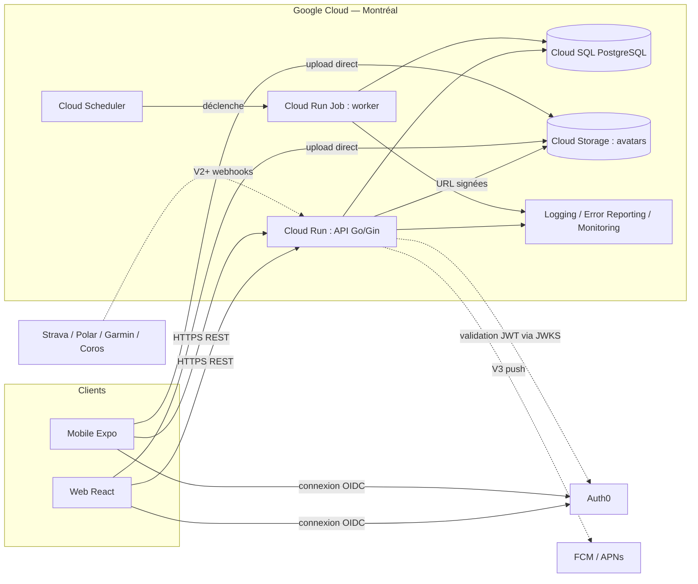
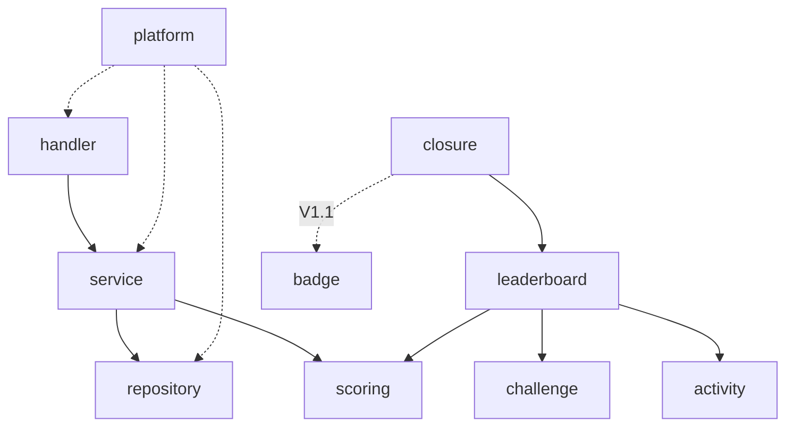

# Sport Challenge — API (backend)

Projet **backend** de l'application de challenges sportifs entre amis : API Go, base PostgreSQL, tâches planifiées.

Le **frontend** (web et mobile) est un projet séparé, avec son propre README. Le contrat entre les deux est la spécification OpenAPI de ce dépôt (`api/openapi.yaml`).

> **Légende** : ✅ décidé · 🟡 proposition par défaut, à confirmer · ❓ question ouverte

---

## 1. Concept

Une personne crée un ou plusieurs challenges sportifs, choisit une durée, la visibilité (privé ou public) et si les participants peuvent inviter à leur tour. Le classement est mis à jour pour chaque catégorie. Les activités sont saisies à la main en V1, puis synchronisées depuis Strava, Garmin, Polar et Coros dans une version ultérieure.

---

## 2. Règles fonctionnelles

### 2.1 Challenges

- ✅ Un utilisateur peut créer plusieurs challenges.
- ✅ Le créateur choisit la durée en **nombre entier de semaines, de 2 à 52** (ex. 6 semaines) : pas de dernière semaine partielle.
- ✅ Le challenge commence à minuit (heure locale) d'un jour choisi entre **aujourd'hui et un an plus tard**, dans son fuseau.
- ✅ Là où un changement d'heure saute minuit (Chili, Égypte, Liban…), le jour commence au **premier instant qui existe** ce jour-là (par exemple 01:00) : jamais la veille. La même règle vaut pour chaque début de semaine.
- ✅ **Catégories à la carte** (décision du 2026-11-20, SC-API-131) : un challenge a **toujours** la catégorie temps cumulé ; le créateur ajoute, s'il le veut, la distance cumulée, l'élimination, la catégorie Points et le D+ cumulé (✅ décision du 2026-11-23, SC-API-168), dans n'importe quelle combinaison (§2.3). Un challenge peut n'avoir que le temps cumulé.
- ✅ **Sport de référence** (SC-API-131) : le créateur choisit, à la création, le sport de référence du challenge parmi les sports du catalogue dont la distance est obligatoire (course, vélo, natation, aviron…) ; **course par défaut**. Les distances de la distance cumulée et du critère de distance des Points y sont ramenées (§2.4), et l'élimination porte sur lui (§2.3).
- ✅ Catégories (D+ cumulé compris), sport de référence et paramètres (coefficients, incrément X, réglages de la catégorie Points, dont ses critères) sont **figés à la création** pour les utilisateurs, créateurs compris ; seul un admin peut les changer (§2.12).
- ✅ **Plusieurs créateurs** possibles pour un même challenge.
- ✅ Visibilité :
  - **Public** : accès libre, listé sur la page d'accueil de l'app.
  - **Privé** : sur invitation d'un créateur ou d'un participant.
- ✅ Le créateur choisit si les participants peuvent aussi inviter du monde (une personne seulement invitée, qui n'a pas rejoint, ne peut pas inviter).
- ✅ **Fuseau horaire** : début et fin sont définis selon le fuseau du lieu de lancement du challenge (ex. Montréal). Les semaines sont découpées dans ce même fuseau.
- ✅ Après le début, on peut modifier le **titre** et la **description**, mais **pas les catégories** (sauf un admin, §2.12).
- ✅ Personne ne « quitte » vraiment un challenge : l'action « quitter » (ou la suppression de son compte, pour les challenges à venir ou en cours) équivaut à un **abandon**. Les créateurs peuvent **supprimer le challenge**.
- ✅ Un challenge est **supprimable à tout moment** par n'importe quel créateur, même en cours et avec des participants, après une confirmation qui avertit que tout disparaît pour tous.
- ✅ Suppression **logique** immédiate : le challenge disparaît pour tous (`deleted_at`), ses lignes restent en base. Il est **restaurable par un admin** à tout moment et n'est **jamais purgé** (✅ 2026-11-23, §2.12).

### 2.2 Participation

- ✅ On peut rejoindre un challenge **jusqu'à la fin de sa première semaine**.
- ✅ Un participant est **classé dans toutes les catégories** du challenge (pas d'inscription par catégorie).
- ✅ Abandonner (« quitter ») un challenge = **éliminé de toutes les catégories**, définitivement (seul un admin peut réintégrer un participant, §2.12).
- ✅ Un participant qui abandonne apparaît comme « a abandonné » et sort du podium.
- ✅ Un compte supprimé ne concourt plus dans les challenges à venir ou en cours, comme après un abandon, et il est **retiré partout** dans tous ses challenges, terminés compris : la personne ne veut plus que ses données soient vues, elle ne peut plus rien gagner et n'est plus comptée. Il n'apparaît plus dans les classements, ni dans la liste ni le nombre des participants, et ses activités ne sont plus visibles (404 `not_found`, comme pour quelqu'un qui n'a jamais rejoint, y compris pour l'exclure ; l'ajouter comme créateur répond `not_active_participant`). Dans un challenge terminé, les autres participants remontent dans les résultats figés (les ex aequo restent ex aequo : 1, 1, 3). ✅ Ses données sont **effacées** de la base, dans la transaction de la suppression, dans tous ses challenges, **supprimés compris** (un challenge restauré par un admin ne les fait pas revenir, §2.12) : activités, participations, éliminations, rôles de créateur, liens d'invitation et ses entrées dans les résultats figés (les rangs, eux, restent recalculés à la lecture et ne sont jamais réécrits). Seuls les challenges qu'il a créés restent, rattachés au compte anonymisé (voir §6). Un compte déjà supprimé quand le worker fige les résultats n'y est pas inscrit.
- ✅ **Dernier créateur** : la suppression d'un compte est **refusée** (`last_creator`, avec la liste des challenges) tant qu'il est le dernier créateur, ayant encore un compte, d'un challenge à venir ou en cours. La personne désigne d'abord un autre créateur (« ajouter un créateur »), ou, s'il n'y a personne à désigner, supprime le challenge elle-même. Un challenge terminé ne bloque rien : il peut rester sans créateur, mais un admin ne le rend plus à venir ou en cours sans en nommer un (§2.12, SC-API-183). Un co-créateur qui a abandonné garde ses droits de créateur (§5.7) et compte donc comme autre créateur. Les liens d'invitation d'un compte supprimé sont **effacés** : une personne qui avait ouvert le lien sans rejoindre perd l'accès au challenge privé ; celles qui ont déjà rejoint restent participantes.
- ✅ Les activités faites avant l'inscription, mais dans la fenêtre du challenge, comptent.
- ✅ **Catégorie Points et suppression d'un compte** (SC-API-131) : les points n'étant jamais stockés (§2.3), un compte supprimé avant le gel des résultats (✅ décision du 2026-11-20 : le gel est le passage du worker qui les fige, au plus tôt à 7 h le premier jour après le challenge, §2.6 ; une suppression faite pendant ce passage le fait reclasser le challenge sans le compte) est retiré de **tous** les mini-classements hebdomadaires, semaines verrouillées comprises : les suivants remontent et reçoivent les points de la place gagnée (personne ne perd de points). Après le gel, comme dans les autres catégories, seuls les rangs se recalculent : les points figés ne bougent plus, sauf correction par un admin, qui les refige (§2.12).

### 2.3 Catégories et podiums

Un challenge a **de 1 à 5 catégories** : le temps cumulé, toujours, et celles que le créateur a choisies (§2.1). **Chaque catégorie a son propre podium**, donc plusieurs gagnants par challenge. Les catégories sont figées à la création (seul un admin peut les changer, §2.12) et affichées dans l'ordre du tableau.

| # | Catégorie | Présence | Activités acceptées | Classement |
|---|---|---|---|---|
| 1 | **Temps cumulé** | toujours | Toutes les activités, tous sports confondus (course, yoga, escalade, aviron…) | Plus de temps cumulé |
| 2 | **Distance cumulée** | au choix | Toutes les activités qui produisent des km, ramenées à une distance du sport de référence si le sport est plus rapide (§2.4) | Plus de distance équivalente cumulée |
| 3 | **Élimination** | au choix | Sport de référence uniquement, en distance réelle | Voir ci-dessous |
| 4 | **Points** | au choix | Selon les critères choisis | Plus de points (voir plus bas) |
| 5 | **D+ cumulé** | au choix | Toutes les activités dont le sport accepte un dénivelé positif (§2.5), en mètres réels, sans coefficient | Plus de D+ cumulé (voir plus bas) |

**Élimination** (la distance du sport de référence doit augmenter chaque semaine ; avec la course pour référence, c'est l'ancienne « course avec élimination ») :
- ✅ Les règles ci-dessous parlent de course et de distance courue : elles valent pour le **sport de référence** du challenge, quel qu'il soit (§2.1), en distance réelle, sans coefficient.
- ✅ **X** est un **incrément en km**, choisi par le créateur à la création du challenge (ex. X = 2 km).
- ✅ Règle : la distance courue en semaine s+1 doit être **au minimum** égale à la distance de la semaine s plus X. Exemple avec X = 2 : semaine 1 = 5 km, donc semaine 2 au moins 7 km, puis semaine 3 au moins (semaine 2) + 2 km, et ainsi de suite jusqu'à la fin du challenge.
- ✅ Au verrouillage d'une semaine (voir plus bas), si cette condition n'est pas remplie, la personne est éliminée **de cette catégorie seulement** et reste en lice dans les autres catégories du challenge.
- ✅ Le gagnant est celui qui a le plus de km cumulés.
- ✅ La « distance de la semaine s » est la distance **réellement courue** par la personne en semaine s. **Si elle court plus que le minimum requis, cette distance devient sa nouvelle base de calcul** : avec X = 2, minimum de 7 km en semaine 2 ; si elle court 10 km, le minimum de la semaine 3 est 12 km. Il n'y a donc pas de distance de départ à régler, et personne n'est éliminé en semaine 1 (pas de référence).
- ✅ Le minimum de la semaine s+1 est **définitif au verrouillage de la semaine s** (à 7 h le premier jour de la semaine suivante) ; avant, il est provisoire, puisqu'une course de la semaine s peut encore être saisie.
- ✅ La distance d'une semaine est le cumul de toutes les courses de la semaine (pas une seule sortie).
- ✅ Les personnes qui terminent le challenge sans être éliminées sont classées par km cumulés, **quelle que soit leur base de départ** : celle qui a couru le plus de km gagne.
- ✅ Viennent ensuite les éliminés : le dernier éliminé est classé devant, et en cas d'égalité sur la semaine d'élimination, la distance cumulée départage.
- ✅ La distance cumulée d'un éliminé s'arrête à la **fin de sa semaine d'élimination** (cette semaine comprise) : ses courses suivantes ne comptent plus, son rang ne bouge plus.
- ✅ **Verrouillage d'une semaine** (décision du 2026-11-20, SC-API-121) : une semaine se verrouille à **7 h, heure locale du challenge, le premier jour de la semaine suivante** (le jour de la fin de la semaine, `week_ends_at` étant le minuit qui l'ouvre), et non à l'instant de sa fin : environ 7 heures plus tard, 6 ou 8 si l'heure change cette nuit-là. La dernière semaine a la même fenêtre : jusqu'à 7 h le premier jour après le challenge (le jour de `ends_at`). Là où un changement d'heure saute ou répète 7 h, c'est le **premier instant qui existe** (comme pour le début d'un jour, §2.1).
  - Jusqu'au verrouillage, une activité datée de la semaine (toutes, pas seulement celles à cheval sur sa fin) peut être **ajoutée, modifiée et supprimée** ; ensuite plus rien ne change (`week_locked`), saisie manuelle comprise, sauf correction par un admin (§2.12). C'est l'horloge qui fait foi, pas le passage du worker.
  - Les bornes des semaines ne bougent pas : une activité compte **entièrement pour la semaine de son début**. Une course du dimanche 23:30 au lundi 00:30 compte pour la semaine qui finit ce dimanche, et se saisit jusqu'au lundi 7 h ; une activité commencée après la fin de la semaine compte pour la suivante.
- ✅ L'élimination d'une semaine est jugée **à son verrouillage** (fuseau du challenge), jamais avant : le délai de grâce va jusqu'à 7 h, heure locale, le premier jour de la semaine suivante. Jugée ensuite, elle ne change plus, sauf recalcul après une correction par un admin (§2.12). ✅ Un participant qui abandonne (ou est exclu) après le verrouillage d'une semaine reste jugé dans les semaines verrouillées avant son départ, même si le worker ne les a pas encore jugées : une élimination de ces semaines reste, et celles verrouillées après son départ ne le jugent plus (même borne que la catégorie Points, `abandoned_at` ≥ verrouillage de la semaine). Ainsi un recalcul admin garde les éliminations jugées avant un abandon (décision du 2026-11-23, SC-API-160).
- ✅ Entre la fin de la semaine s et son verrouillage, le classement et « Mes défis » montrent la **semaine s+1** (celle de l'horloge) : personne n'est encore éliminé pour la semaine s, et le minimum de la semaine s+1 est **provisoire** (distance actuelle de la semaine s + X) ; il peut encore monter jusqu'à 7 h. Le statut live de la semaine s+1 se calcule avec ce minimum provisoire.
- ✅ Le statut live affiche « objectif atteint » dès que la distance de la semaine atteint le minimum ; sinon « à risque » quand il reste **24 h ou moins** avant la fin de la semaine, et « en cours » avant. Aucun statut en semaine 1 (pas de minimum). Le seuil de 24 h est un paramètre de configuration.
- ✅ La liste « Mes défis » montre, pour chaque challenge en cours où la personne participe encore, sa semaine (numéro, fin, et dans l'élimination la distance, le minimum et le statut live ci-dessus ; dans la catégorie Points, ses points provisoires) et son **rang dans chacune des catégories du challenge**, sous la forme « rang sur nombre de classés » (ex aequo compris : 1, 1, 3 ; les abandons et les comptes supprimés ne sont pas comptés). Les valeurs sont celles du classement au même instant. Rien pour un challenge à venir ou terminé, ni pour qui a abandonné.

**Catégorie D+ cumulé** (décisions du 2026-11-23, SC-API-168) :
- ✅ **Facultative** : le créateur la coche à la création, comme la distance cumulée ou l'élimination ; figée ensuite avec les autres catégories (§2.1, seul un admin la change, §2.12).
- ✅ Elle cumule le **dénivelé positif (D+)** de toutes les activités du participant dans la fenêtre du challenge, **tous les sports** où le D+ est autorisé (course, marche, randonnée, vélo, roller, ski de fond, « autre » avec distance, §2.5), en **mètres réels**, **sans coefficient** ni sport de référence. Une activité sans D+ compte pour **0 m**.
- ✅ Classement : le plus de D+ cumulé gagne ; égalité : ex aequo (1, 1, 3). Les abandons et les comptes supprimés sont traités comme dans la distance cumulée (abandon : « a abandonné », sans rang ; compte supprimé : retiré, les autres remontent, §2.2). Les résultats se figent avec les autres catégories (§2.6).
- ✅ **Position fixe 5** (✅ confirmé le 2026-11-23) : ajoutée à la fin du tableau, sans renuméroter les catégories existantes ni les résultats déjà figés.

**Catégorie Points** (décision du 2026-11-20, SC-API-131) :
- ✅ Le créateur coche, à la création, les **critères** de la catégorie (au moins un) :
  1. **séance la plus longue en temps** (tous les sports) ;
  2. **séance la plus longue en distance équivalente** (distance ramenée au sport de référence avec les coefficients du challenge, comme la distance cumulée, §2.4 ; une activité sans distance ou d'un sport sans coefficient n'y compte pas) ;
  3. **nombre de séances** de la semaine ; une séance ne compte que si sa durée atteint un **minimum fixé par le créateur** (pré-rempli à 20 min, de 1 à 180 min) ;
  4. **D+ de la semaine** (✅ décision du 2026-11-23, SC-API-168) : le dénivelé positif cumulé de la semaine, en mètres réels, sans coefficient, tous les sports qui en acceptent un (§2.5) ; une activité sans D+ compte pour 0 m.
- ✅ Chaque semaine, chaque critère donne un **mini-classement**, et les points vont au **top 5** (10, 8, 6, 4, 2) ou au **top 10** (25, 18, 15, 12, 10, 8, 6, 4, 2, 1), au choix du créateur.
- ✅ Ex aequo dans un mini-classement : même rang et mêmes points (1, 1, 3), y compris à la limite du top (trois ex aequo au 5ᵉ rang reçoivent chacun les points du 5ᵉ). Une valeur nulle (aucune séance qui compte, ou 0 m de D+ dans la semaine) ne marque pas.
- ✅ Les points d'une semaine sont **acquis à son verrouillage** (7 h, heure locale, le premier jour de la semaine suivante), semaine 1 comprise. Avant, ils sont **provisoires** : le classement les montre à part (« 43 pts + 12 provisoires »), et le rang se calcule sur les points acquis seuls. Entre la fin d'une semaine et son verrouillage, ses points restent provisoires.
- ✅ Le gagnant a le plus de points acquis à la fin ; égalité : ex aequo (1, 1, 3). Un participant qui abandonne (ou qui est exclu) **reste** dans les mini-classements des semaines verrouillées avant son départ : les points de ces semaines ne bougent pas, ni les siens ni ceux des autres. Il sort des mini-classements des semaines verrouillées ensuite, et apparaît « a abandonné », sans rang ni total, comme dans les autres catégories (décision du 2026-11-20). Seule la suppression d'un compte, qui efface ses activités, redistribue les points (§2.2).
- ✅ Les points ne sont **jamais stockés** : ils se recalculent à la lecture depuis les activités, puis se figent avec les autres catégories quand le worker fige les résultats, après le verrouillage de la dernière semaine (§2.6). Les points acquis ne baissent jamais ; ils ne montent après coup que si un compte est supprimé avant le gel (§2.2). Seule exception : une correction par un admin recalcule le challenge, et ses points acquis peuvent alors changer dans les deux sens (§2.12).
- ✅ **Détail des points d'un participant** (décisions du 2026-11-23, SC-API-173) : l'app montre d'où viennent les points, **semaine par semaine et critère par critère** : pour chaque semaine commencée, le rang du participant dans le mini-classement de chaque critère (aucun rang pour une valeur nulle, qui ne marque pas), sa valeur et les points obtenus, le total de la semaine, et les totaux acquis et provisoires, identiques à ceux du classement au même instant. Le détail de **tout participant** est visible de qui voit le classement ; les **valeurs** (durée, distance, nombre de séances, D+ de chaque critère) seulement de qui voit les activités des participants (§5.7 : participants, abandons compris, créateurs, admins), les autres lecteurs du classement n'ayant que les rangs et les points (décision du 2026-11-23). Pour un participant qui a abandonné (ou a été exclu) : seulement les semaines verrouillées avant son départ. Au gel des résultats, le détail est **écrit avec eux** dans le résultat figé de la catégorie Points (seule exception à « jamais stockés », comme le classement figé lui-même), et un recalcul admin le refige. Un défi sans catégorie Points n'a pas de détail (404).
  - ✅ Un participant qui a abandonné (ou a été exclu) a dans son détail le total de ses semaines affichées (celles verrouillées avant son départ), même si le classement le montre sans total (décision du 2026-11-23).
  - ✅ Après le gel, la suppression d'un compte ne change pas le détail figé des autres : leurs rangs dans les mini-classements hebdomadaires restent ceux du gel, comme leurs points ; seul le rang de la catégorie se recalcule (§2.2) (décision du 2026-11-23).
  - ✅ Un défi figé avant que le détail ne soit enregistré (avant SC-API-173) a son détail calculé à la lecture depuis les activités ; si un compte a été supprimé après son gel, ce détail peut ne plus correspondre au total figé, et un recalcul admin (§2.12) les remet en accord (décision du 2026-11-23).

### 2.4 Équivalences de distance (distance cumulée et critère de distance des Points)

- ✅ Les distances sont ramenées à une distance du **sport de référence** du challenge (§2.1 ; course par défaut).
- ✅ Les coefficients du catalogue sont exprimés **par rapport à la course** :

| Activité | Coefficient (référence course) |
|---|---|
| Course | ×1 |
| Marche, randonnée, natation et autres sports à km plus lents | ×1 |
| Vélo | ×0,3 |
| Aviron | ×0,5 |
| Roller | ×0,5 |
| Ski de fond | ×0,5 |
| Hyrox | ×1 |
| Parapente | ×0,3 |

- ✅ **Autre référence** (décision du 2026-11-20, SC-API-131) : le coefficient suggéré d'un sport est `min(1, coefficient du sport / coefficient de la référence)`, arrondi à deux décimales (la moitié vers le haut) et jamais sous 0,1. Les activités **plus lentes que la référence** comptent donc **sans coefficient** (1 pour 1), comme la marche par rapport à la course ; aucune suggestion n'est majorée. Exemples : référence vélo → vélo ×1, course ×1, aviron ×1 ; référence aviron → vélo ×0,6, course ×1.
- ✅ Ce sont des **suggestions** : le **créateur choisit les coefficients de son challenge** à la création (pré-remplis par ces suggestions), entre **0,1 et 2**. Le sport de référence vaut toujours ×1 et son coefficient ne s'envoie pas à la création (refusé même à 1).
- ✅ Les coefficients existent dès que la distance cumulée **ou** le critère de distance de la catégorie Points est choisi ; sinon il n'y en a pas, et la création les refuse.
- ✅ Les coefficients sont **figés à la création du challenge** : ni une modification ultérieure du catalogue ni les créateurs ne les changent pour un challenge en cours (seul un admin le peut, §2.12).
- ✅ La distance équivalente est **sommée exactement**, puis **arrondie au mètre** (demi-mètre vers le haut) une seule fois, sur le total de chaque participant : deux totaux à moins d'un mètre l'un de l'autre peuvent être ex aequo.
- ✅ Un sport à distance **ajouté au catalogue après la création** d'un challenge n'a pas de coefficient figé dans ce challenge : ses activités comptent pour le temps cumulé, mais ni pour la distance cumulée ni pour le critère de distance des Points.
- Conséquence assumée : la marche compte pleinement, donc un marcheur peut battre un coureur en distance pure ; de même, dans un challenge vélo, 10 km courus valent 10 km de vélo.

### 2.5 Activités

- ✅ **V1 : saisie manuelle uniquement.** Les synchronisations Strava, Garmin, Polar et Coros arrivent après.
- ✅ **Impossible d'importer une activité après la fin** du challenge.
- ✅ Une activité compte selon sa date de début, dans la fenêtre du challenge, entièrement pour la semaine de son début (même si elle finit dans la suivante).
- ✅ Un participant peut ajouter, modifier ou supprimer ses propres activités d'une semaine jusqu'à son **verrouillage, à 7 h le premier jour de la semaine suivante** (heure locale du challenge) ; ensuite plus rien ne change (voir §2.3), sauf correction par un admin (§2.12). Une activité à cheval sur la fin d'une semaine se saisit donc une fois finie, dans cette fenêtre.
- ✅ Toutes les activités ont une **durée** ; la distance n'est demandée que pour les sports qui en produisent (pas le yoga, par exemple).
- ✅ La **vitesse (ou l'allure) n'est jamais saisie** : elle est calculée automatiquement à partir de la durée et de la distance.
- ✅ **Dénivelé positif (D+)** (décisions du 2026-11-23, SC-API-149) : **facultatif**, en mètres entiers, de 0 à **20 000 m** (borne technique contre les erreurs de saisie). Il ne se saisit que pour les sports où il a un sens : course, marche, randonnée, vélo, roller, ski de fond et « autre » (le catalogue le dit sport par sport, `elevation_allowed`), et **seulement si l'activité a une distance** ; il est refusé pour la natation, l'aviron, l'Hyrox, le parapente et les sports sans distance (`elevation_not_allowed`). ✅ Il compte pour la **catégorie D+ cumulé** et le **critère « D+ de la semaine »** de la catégorie Points (décisions du 2026-11-23, SC-API-168, §2.3), et **pour rien d'autre** : ni le temps, ni la distance, ni l'élimination, ni les autres critères des Points, ni les badges (§2.7). Une modification remplace tous les champs saisis : un D+ omis est retiré, et une modification qui retire la distance doit retirer le D+ aussi. Le verrouillage des semaines s'applique comme aux autres champs.
- ✅ **Activités cohérentes** (SC-API-084) :
  - deux activités d'un même utilisateur ne se **chevauchent jamais** (`activity_overlap`), chacune occupant l'intervalle [début, début + durée) ; des activités **à la suite** restent permises (un triathlon : natation, puis vélo, puis course, la fin de l'une étant le début de la suivante) ; une activité supprimée ne compte plus ; la modification d'une activité ne revérifie le chevauchement que si son début ou sa durée change ;
  - une activité se saisit une fois **finie** : sa fin (début + durée) n'est jamais dans le futur, avec la même tolérance de 5 minutes que pour le début ;
  - le début n'est jamais antérieur au **1er janvier 2000 à 00:00 UTC** (borne technique contre les erreurs de saisie).
- 🟡 Les activités saisies à la main sont marquées « manuelle » (surtout utile à partir de la V2, quand des activités synchronisées s'ajoutent).
- ❓ Aucun plafond de vitesse en V1 par défaut (seulement des bornes techniques : durée et distance positives, valeurs maximales raisonnables). À revoir si des abus apparaissent.
- ✅ Un **catalogue de sports** définit, pour chaque sport : si la distance est obligatoire, interdite ou facultative (« autre »), son coefficient suggéré (§2.4) et s'il accepte un dénivelé positif.
- ✅ **CrossFit, Hyrox et parapente** (décisions du 2026-11-23, SC-API-174) : le CrossFit n'a pas de distance (comme la musculation) ; l'Hyrox (×1) et le parapente (×0,3) ont une distance **obligatoire** et peuvent donc être choisis comme sport de référence (§2.1) ; aucun des trois n'accepte de D+. Ils s'ajoutent par la migration 000020, sans toucher aux défis existants (§2.4 : un sport à distance ajouté après la création ne compte que pour le temps cumulé de ces défis). Annuler cette migration ne retire que les sports qu'aucune activité, aucun sport de référence ni aucun coefficient figé d'un défi n'utilise.
- ✅ Un utilisateur peut **saisir un sport à la main** s'il n'est pas proposé : il choisit « autre » et écrit un libellé libre (2 à 40 caractères). ✅ Un sport saisi à la main compte toujours pour le **temps cumulé** ; la distance est **facultative** : s'il y en a une, il compte aussi pour la distance cumulée (✅ coefficient de catalogue ×1, ramené au sport de référence comme les autres, §2.4, et modifiable par le créateur), sinon non.
- ✅ **Une activité est saisie une seule fois** et compte dans **tous** les challenges où l'utilisateur est participant actif et dont la fenêtre la contient ; ✅ une activité hors de toute fenêtre est acceptée et comptera si l'utilisateur rejoint un challenge dont la fenêtre la contient (voir `docs/adr/0001-activity-scope.md`). Conséquence : une activité est non modifiable dès que sa semaine est verrouillée dans **l'un** de ces challenges, chacun avec son fuseau. ✅ Un challenge quitté (abandon ou exclusion) verrouille encore les semaines déjà verrouillées à l'instant du départ, pour que les points de ces semaines ne bougent plus (§2.3, SC-API-140).

### 2.6 Classement et équité

- ✅ Aucun handicap ni catégorie de niveau : tout le monde est traité à la même enseigne.
- ✅ **V1 : mise à jour du classement au rafraîchissement** de l'écran (pas de temps réel instantané).
- ✅ **Cache court** (décision du 2026-11-24, SC-API-181) : le classement calculé d'un challenge est gardé **5 secondes** en mémoire de l'instance et servi aux lectures suivantes du classement, de ses pages et du détail des points ; la mise à jour au rafraîchissement se fait donc à quelques secondes près : après la saisie d'une activité, le classement peut montrer l'ancien rang pendant ce délai, sur chaque instance ; de même, un compte supprimé (§2.2), un abandon, une exclusion ou une correction admin (§2.12) peuvent n'apparaître dans le classement qu'au plus 5 secondes plus tard. Il ne survit jamais au verrouillage d'une semaine (l'entrée expire à cet instant, même pendant son calcul) ni à un changement des catégories ou des dates ; les autres changements d'état liés à l'heure (début d'une semaine à minuit local, passage « à risque » de l'élimination) se voient eux aussi à 5 secondes près, et « Mes défis », calculé à chaque lecture, peut précéder le classement d'autant. Les droits sont vérifiés à chaque lecture, avant le cache.
- ✅ Égalités : classement **ex aequo** (1, 1, 3), sans départage arbitraire.
- ✅ Résultats **figés** au verrouillage de la dernière semaine (7 h le premier jour après le challenge (le jour de `ends_at`)). Le challenge est « terminé » dès sa date de fin ; entre la fin et 7 h, le classement servi est calculé depuis les activités (la dernière semaine n'est pas encore jugée), puis les résultats figés le remplacent. Exceptions : un compte supprimé en est retiré et les autres remontent (§2.2) ; une correction admin les rouvre et les refige par un recalcul (§2.12).
- ✅ Le classement est toujours recalculé à partir des activités brutes. Le cache court ci-dessus n'est pas un total stocké : il garde en mémoire un classement calculé depuis les activités brutes, jamais en base.
- ✅ **Affichage des listes** (décisions du 2026-11-23, SC-API-171) : partout où une liste s'affiche, l'utilisateur choisit d'en afficher **10, 50 ou tout** (choix côté client). Dans le classement, le **podium** (rangs 1 à 3, ex aequo compris) est **toujours visible** ; ✅ une valeur nulle n'y monte pas (en début de défi, tout le monde est ex aequo à 0 : le podium est alors vide), puis vient la liste paginée selon ce choix ; la **ligne de l'utilisateur** est toujours affichée, même hors de la page.

### 2.7 Badges

- ✅ **(V1.1, après la V1)** Le créateur d'un challenge peut créer **autant de badges qu'il veut** pour ce challenge. Pour chaque badge : un nom, une description et une **condition**.
- ✅ Dès qu'un participant atteint la condition, il gagne le badge (attribution immédiate, pas seulement en fin de semaine).
- ✅ Mesures possibles : **nombre d'activités**, **distance** et **temps**. La distance d'un badge est la distance **réelle**, sans coefficient ; un badge peut être limité à un sport. Exemples : un badge à 5, à 10 et à 20 activités ; un badge à 100 km cumulés ; un badge à 10 heures cumulées.
- 🟡 Une condition est une **règle structurée** (pas de code libre) : une mesure, une portée (sur tout le challenge, sur une semaine, sur une seule sortie, ou plusieurs semaines de suite), un filtre de sport (tous, course seule ou un sport donné) et un seuil (« au moins »). Les portées et le filtre se compléteront sans changer le modèle, puisque la règle est stockée en JSON.
- ✅ Un badge s'obtient une seule fois par participant. Une fois gagné, il est conservé même si l'activité est ensuite modifiée ou supprimée pendant la semaine en cours.
- ✅ Un badge créé en cours de challenge est évalué aussi sur les activités déjà enregistrées.
- 🟡 Un badge déjà gagné par quelqu'un ne peut plus être supprimé ni modifié.
- ✅ Limite de 50 badges par challenge (chaque activité déclenche l'évaluation des badges du challenge pour son auteur).

### 2.8 Profil et langues

- ✅ Pseudo et avatar. Le pseudo est **facultatif** (décision du 2026-11-20, SC-API-118) ; quand il est saisi, il est **unique sans tenir compte de la casse**, de 3 à 20 caractères (lettres, chiffres, `_`, `.`, `-`).
- ✅ Les lettres du pseudo sont **ASCII** (`a-z`, `A-Z`, sans accent) : l'unicité sans tenir compte de la casse est la même partout, et deux pseudos ne peuvent pas se ressembler à l'œil en étant différents.
- ✅ **Prénom et nom** : saisis par l'utilisateur dans son profil, chacun de 1 à 50 caractères : des lettres de tout alphabet (accents compris), en mots séparés par une espace, `-`, `'` ou `’`, chaque mot commençant par une lettre, sans espace au début ni à la fin. Les autres utilisateurs voient le pseudo (s'il est saisi), le prénom et le nom (participants, classements ; pour un challenge public, tout utilisateur connecté). Décision du propriétaire du produit du 2026-11-19 (SC-API-116).
- ✅ **E-mail** : il vient du fournisseur d'authentification (claim ajoutée à l'access token par une Action Auth0, `docs/auth0-setup.md`), tenu à jour à chaque requête s'il change ; il n'est pas modifiable dans le profil et n'est visible que de son titulaire (`GET /me`) et des admins (fiche utilisateur, §2.12), jamais des autres utilisateurs (SC-API-116 ; admins : décision du 2026-11-23).
- ✅ Le profil est **complet** dès que le prénom et le nom sont saisis, avec ou sans pseudo (SC-API-118 ; un profil créé avant SC-API-116 n'a que le pseudo et reste incomplet jusqu'à la saisie des noms ; comme la saisie d'une activité exige aussi un profil complet, ADR 0001, l'app doit demander les noms dès la connexion). Le prénom et le nom ne peuvent plus être retirés, seulement changés ; le pseudo, facultatif, peut être retiré (`PATCH /me` avec `pseudo: null`). **Créer ou rejoindre un challenge exige un profil complet** (erreur `profile_incomplete`).
- ✅ En V1, l'avatar affiché est formé des initiales du pseudo s'il y en a un, sinon des initiales du prénom et du nom (choix d'affichage des apps) ; l'envoi d'une image vient en V1.1.
- ✅ **Chiffres du profil** (`GET /me/activities/summary`, SC-API-148) : le nombre d'activités et leur **durée totale** portent sur toutes les activités de l'utilisateur, supprimées exclues, qu'elles comptent dans un challenge ou non. Le **nombre de défis** compte les challenges que l'utilisateur a **rejoints**, quel que soit leur statut (à venir, en cours, terminés), **abandonnés compris** (exclusion comprise) ; pas ceux qu'il a seulement créés sans y participer, ni les challenges supprimés. Décision du propriétaire du produit du 2026-11-23.
- ✅ Langues : **français et anglais**.
- ✅ Unité : **km uniquement** pour le moment.

### 2.9 Modération et litiges

- ✅ Pas de système de contestation pour l'instant.
- ✅ Les créateurs peuvent ajouter un créateur et exclure un participant.
- ✅ Un participant exclu par un créateur apparaît comme un abandon (« a abandonné »), sans mention particulière ; il est éliminé de toutes les catégories, définitivement.
- ✅ Seul un participant actif peut devenir créateur (tout créateur est donc participant) ; ajouter quelqu'un qui est déjà créateur ne change rien (même après la fin) ; nommer un nouveau créateur n'est plus possible une fois le challenge terminé (sauf pour un admin, §2.12).
- ✅ Un créateur ne peut pas être exclu par un autre créateur (les créateurs sont à égalité ; un créateur peut toujours abandonner lui-même) ; seul un admin le peut (§2.12). Une exclusion n'est plus possible une fois le challenge terminé, et exclure quelqu'un qui a déjà abandonné ne change rien.
- ✅ Pas de système de contestation en V1 : les participants se font confiance. Les corrections qu'aucun utilisateur ne peut faire (semaine verrouillée, réglage figé, inscription close, résultats figés) passent par un admin (§2.12).
- ✅ **Pas de plafond de volume par utilisateur** (SC-API-083) : ni sur le nombre de challenges créés, ni sur les invitations, ni sur les activités par jour. La seule protection contre les abus est la **limite de débit** (par adresse IP, et par utilisateur sur les écritures, §5.7), tenue en mémoire par instance. À revoir si des abus apparaissent, notamment des challenges publics en masse sur la page d'accueil.

### 2.10 Modèle économique

- ✅ Gratuit pour le moment.

### 2.11 Page de présentation (landing page)

Décisions du propriétaire du produit du 2026-11-23 (SC-API-151) :

- ✅ Une **page de présentation publique** s'affiche à `/` pour un visiteur **non connecté** ; une personne connectée voit à la place la page d'accueil de l'app, avec ses défis (côté frontend). Elle est servie par le frontend, avec un **contenu statique** : elle n'appelle pas l'API, qui exige une connexion pour toutes ses routes (§5.7). Elle ne liste donc pas les challenges publics, lisibles seulement par un utilisateur connecté (§2.1, §5.7).
- ✅ Elle ne présente que des règles ✅ de ce README, sans en inventer ni en promettre d'autres, et suit leur évolution. Elle explique, dans cet ordre :
  1. **Le principe** (§1, §2.1) : créer un défi entre amis, en choisir la durée (de 2 à 52 semaines), la date de début, la visibilité (privé ou public) et si les participants peuvent inviter ; saisir chaque activité **une seule fois** : elle compte dans tous les défis où l'on participe et dont la période contient sa date (§2.5). Gratuit (§2.10).
  2. **Les semaines** (§2.1, §2.3, §2.5) : découpées dans le fuseau du défi ; une activité compte pour la semaine de son début et se saisit, se modifie ou se supprime jusqu'au **verrouillage**, à 7 h, heure locale du défi, le premier jour de la semaine suivante.
  3. **Les catégories**, chacune avec son **podium** (§2.3) : le **temps cumulé**, toujours, tous sports confondus ; au choix du créateur, la **distance cumulée** (distances ramenées au sport de référence, §2.4), l'**élimination** (la distance du sport de référence doit atteindre chaque semaine celle de la semaine précédente plus X km ; pas d'élimination en semaine 1), les **Points** (mini-classements hebdomadaires, points au top 5 ou au top 10) et le **D+ cumulé** (dénivelé positif cumulé, en mètres, tous les sports qui en acceptent un). Chaque participant est classé dans toutes les catégories du défi (§2.2).
  4. **La participation** (§2.2, §2.6) : on rejoint un défi jusqu'à la fin de sa première semaine ; quitter un défi, c'est abandonner toutes ses catégories, définitivement ; les égalités sont des ex aequo (1, 1, 3) ; il n'y a ni handicap ni catégorie de niveau.
- ✅ Les fonctionnalités prévues après la V1 (notamment la synchronisation Strava, Garmin, Polar et Coros et les badges, §7) **n'y figurent pas**, même comme « bientôt ».

### 2.12 Administration

Décisions du propriétaire du produit du 2026-11-23 (SC-API-152). Il n'y a pas de système de contestation (§2.9) et, pour les utilisateurs, les verrous du produit sont absolus : semaines verrouillées, réglages figés à la création, inscriptions closes après la semaine 1, résultats figés. L'administration permet de corriger un défi après coup et de voir l'état de l'app (comptes, défis, worker) sans passer par la base.

**Qui est admin**

- ✅ Un compte qui a le **rôle Auth0 « admin »**, porteur de la permission `admin`, attribué à la main par le propriétaire du produit dans la console Auth0 (RBAC activé et « Add Permissions in the Access Token » sur l'API Auth0). L'API lit la permission dans la claim `permissions` de l'access token ; rien n'est stocké en base. Retirer le rôle prend effet à l'expiration de l'access token en cours.
- ✅ Une Action post-login Auth0 exige la **double authentification** de tout compte qui a le rôle.
- ✅ Un seul admin pour l'instant ; le modèle en accepte plusieurs.
- ✅ Un admin est par ailleurs un utilisateur comme les autres : il crée, rejoint et concourt.
- ✅ Pas de connexion à la place d'un utilisateur, même en lecture seule.

**Ce que l'admin voit**

- ✅ **Tous les défis**, privés et supprimés compris, avec tout ce que voit un créateur, plus les liens d'invitation (actifs, expirés, révoqués), les semaines verrouillées, les éliminations, l'état des résultats figés et les corrections admin.
- ✅ Sur les routes existantes (détail, classement, participants, activités d'un défi), l'admin a la **lecture d'un créateur**, sur tous les défis non supprimés : l'app réutilise ses pages. Pour lui, un défi privé non supprimé n'est jamais en 404. Ces routes ne lui donnent **aucun** droit d'écriture : rejoindre, modifier ou exclure y suivent les règles normales ; ses modifications passent par les routes `/admin/*`.
- ✅ **Tous les utilisateurs**, e-mail compris : état (actif, bloqué, supprimé, suppression Auth0 en attente), date d'inscription, dernière activité, défis, activités. ✅ Recherche sur le pseudo, le prénom, le nom et l'e-mail, sans tenir compte de la casse (les accents comptent) ; un compte supprimé n'en a plus et n'est donc jamais trouvé par la recherche. La recherche voyage dans le **corps** de `POST /admin/users/search` (lecture seule), jamais dans l'URL : les journaux de requêtes de la plateforme enregistrent les URL complètes, et la recherche peut être un e-mail (§5.7). La **dernière activité** est la date de saisie de la dernière activité, comme le compte actif du tableau de bord, activités supprimées exclues ; les **défis** d'un compte sont ceux qu'il a rejoints ou dont il est créateur, supprimés compris, avec son rôle (créateur, participant actif ou ayant abandonné) ; ses activités excluent les activités supprimées. Les défis et les activités d'un compte sont des listes paginées. Un compte supprimé est « suppression Auth0 en attente » tant que `retry-auth0-deletions` n'a pas supprimé son identité chez Auth0, puis « supprimé » (une suppression en attente enregistrée avant ce lien, SC-API-158, ne nomme aucun compte : le compte s'affiche « supprimé ») ; un compte non supprimé qu'un admin a bloqué est « bloqué » (SC-API-165) (décisions du 2026-11-23, SC-API-158).
- ✅ Un **tableau de bord** : comptes (total, nouveaux sur 7 jours, actifs sur 7 jours), défis par statut et supprimés, activités de la semaine, suppressions Auth0 en attente, dernier passage et dernier échec de chaque tâche du worker, version de l'API. ✅ « Sur 7 jours » et « de la semaine » : les 7 × 24 h qui précèdent la lecture, sans fuseau ; les activités comptées et le compte **actif** (au moins une activité) portent sur la date de saisie, quelle que soit la date de la séance, activités supprimées exclues ; les comptes supprimés ne comptent dans aucun chiffre de comptes ni d'activités ; le nombre de comptes bloqués (non supprimés, comptés aussi dans le total) s'y ajoute (SC-API-165) (décisions du 2026-11-23, SC-API-156). ✅ Parmi les suppressions Auth0 en attente, le nombre de **bloquées** : celles qu'Auth0 a refusées pour de bon au dernier essai (réponse 4xx propre au compte, comme un identifiant mal formé ; ni 404, 408 et 429, ni 401 et 403, qui refusent toutes les suppressions, jeton ou permission `delete:users` retirés, et font encore échouer la tâche pour que son alerte parte). `retry-auth0-deletions` les rejoue encore à chaque passage, pour reprendre seul une fois la cause corrigée, mais elles ne font plus échouer la tâche : chacune est journalisée en ERROR avec l'identifiant du compte local, jamais l'identifiant Auth0 (SC-API-188).
- ✅ Le **journal** des actions admin.

**Ce que l'admin peut modifier**

✅ L'admin passe outre les verrous **de temps** (semaines verrouillées, inscriptions closes, défi terminé, résultats figés) et **de rôle** (créateur, participant). Il ne passe jamais outre la **validation des données** : bornes et formats restent ceux des utilisateurs (2 à 52 semaines, coefficients de 0,1 à 2, incrément X, pseudo, prénom, nom, durée et distance d'une activité…).

| Bloqué pour un utilisateur | Ce que l'admin peut faire |
|---|---|
| Catégories, sport de référence, coefficients, incrément X, réglages de la catégorie Points | Les modifier, ajouter ou retirer une catégorie (le temps cumulé reste obligatoire) (✅) |
| Durée, premier jour, fuseau | Les changer, défi en cours ou terminé compris (✅) |
| Visibilité, « les participants peuvent inviter » | Les changer (✅) |
| Titre, description | Les changer, comme un créateur (✅) |
| Inscriptions closes après la semaine 1 | Ajouter n'importe quel utilisateur au profil complet comme participant, à tout moment (✅) |
| Abandon et exclusion définitifs | Réintégrer un participant (✅) |
| Rôles de créateur | Nommer un créateur (même après la fin), retirer un rôle de créateur, exclure un créateur ; un défi garde toujours au moins un créateur (✅) : un défi à venir ou en cours n'en reste jamais sans (voir « Défi sans créateur » ci-dessous) |
| Semaines verrouillées | Ajouter, modifier ou supprimer l'activité de n'importe quel utilisateur, dans n'importe quelle semaine (✅) |
| Éliminations | Pas de forçage : une élimination se corrige par ses causes (activités, réglages, participants), dont la correction recalcule le défi (✅ 2026-11-24, SC-API-167 abandonné) |
| Résultats figés | Ils sont rouverts et refigés par le recalcul (✅) |
| Défi supprimé | Le restaurer, à tout moment ; supprimer un défi (✅) |
| Comptes | Modifier pseudo, prénom et nom ; bloquer et débloquer ; supprimer (même effet que `DELETE /me`, suppression chez Auth0 comprise, et même refus `last_creator` tant que le compte est le dernier créateur d'un défi à venir ou en cours : l'admin nomme d'abord un autre créateur ou supprime le défi) (✅) |

- ✅ **Réglages d'un défi** (`PATCH /admin/challenges/{id}`, décisions du 2026-11-23, SC-API-161) : tous les champs de la création, validés par les mêmes règles, sauf le premier jour, qui peut être dans le passé, sans limite (au plus un an d'avance, comme à la création) ; un champ absent garde sa valeur ; `categories` remplace les catégories au choix (celles qu'il omet sont retirées, le temps cumulé reste). Un nouveau sport de référence repart des coefficients suggérés ramenés à lui ; sinon les coefficients du défi restent ; `distance_factors` remplace ensuite ceux qu'il nomme. Un nouveau premier jour ou fuseau recale l'expiration des liens d'invitation non révoqués sur la nouvelle fin de semaine 1 (un lien expiré peut redevenir valide). Conséquences, elles aussi décidées le 2026-11-23 :
  - le défi est revérifié en entier à chaque modification, champs inchangés compris : un sport de référence qui ne serait plus « distance obligatoire » dans le catalogue fait refuser la modification (`reference_sport`) ;
  - un changement de fuseau seul garde le même jour local de départ : l'instant de début, la fenêtre et donc les activités qui comptent se déplacent ;
  - une modification qui ne change rien recalcule quand même le défi, et écrit sa ligne de journal (valeurs vides) ;
  - un défi supprimé ne se modifie pas (404 `challenge_not_found`) : l'admin le restaure d'abord ;
  - un changement après lequel un défi sans aucun créateur ayant encore un compte est à venir ou en cours (statut calculé après la modification) est refusé (422 `no_creator`), aperçu compris : l'admin nomme d'abord un créateur par la route « nommer un créateur », ouverte aux défis terminés ; le même changement qui le laisse terminé passe (SC-API-183).
- ✅ **Participants et créateurs d'un défi** (`/admin/challenges/{id}/participants` et `/creators/{userId}`, SC-API-162), à tout moment, défi terminé compris, chacun avec motif, aperçu, recalcul et journal (cible : le compte, comme participant) :
  - **ajouter** un participant : tout compte au profil complet (`profile_incomplete` sinon) ; un participant actif (créateur compris) répond `already_participant`, un compte qui a abandonné ou a été exclu, créateur compris, `participation_abandoned` (l'admin le réintègre), un compte inconnu ou supprimé `user_not_found` ;
  - **réintégrer** : l'abandon ou l'exclusion est annulé, la participation redevient active et les semaines déjà verrouillées sont rejugées avec elle ;
  - **exclure** un participant, créateur compris ; ✅ un créateur exclu **garde** son rôle, comme un créateur qui abandonne (§5.7) : l'admin le retire à part (décision du 2026-11-24) ; ✅ l'exclusion est datée de l'instant de l'action, jamais antidatée : comme pour tout départ, les semaines déjà verrouillées gardent les points du participant et restent verrouillées pour ses activités (décision du 2026-11-24) ;
  - **nommer un créateur** : ✅ tout participant, actif ou ayant abandonné (décision du 2026-11-24) ; quelqu'un qui n'a jamais rejoint, ou un compte supprimé, répond `not_active_participant` : l'admin l'ajoute d'abord ;
  - **retirer un rôle de créateur** : la participation reste telle quelle ; le dernier créateur ne se retire pas (`last_creator`) ;
  - une action qui ne change rien (réintégrer un participant actif, exclure quelqu'un déjà sorti, nommer un créateur, retirer le rôle d'un non-créateur) répond quand même, recalcule le défi et écrit sa ligne de journal (valeurs vides), comme une modification de réglages sans effet ; quelqu'un qui n'a jamais rejoint, ou un compte supprimé, répond `not_found` (réintégrer, exclure, retirer un rôle) ;
  - un défi supprimé ne se modifie pas (404 `challenge_not_found`) : l'admin le restaure d'abord ;
  - chaque action verrouille d'abord la ligne du compte touché, juste après le verrou des semaines, dans l'ordre d'une suppression de compte : une correction et la suppression du même compte au même moment passent l'une après l'autre, jamais en interblocage.
- ✅ Une activité corrigée par l'admin l'est **partout** : tous les défis où elle compte (§2.5) sont recalculés, et l'aperçu les liste. ✅ Ce sont les défis où elle compte **avant et après** la modification (une date changée peut la faire passer d'un défi à l'autre), y compris ceux que l'auteur a quittés après le verrouillage de sa semaine, où la catégorie Points et l'élimination le jugent encore (§2.3) ; tous sont recalculés et nommés dans sa ligne de journal (décisions du 2026-11-24, SC-API-163).
- ✅ L'admin ajoute, modifie et supprime l'activité de n'importe quel compte, dans n'importe quelle semaine, défi terminé compris, avec les validations d'une saisie (profil complet pour un ajout, bornes, sport, distance, D+, chevauchement) ; une activité absente, supprimée ou d'un compte supprimé répond `activity_not_found`, un compte absent ou supprimé `user_not_found` (SC-API-163).
- ✅ Une activité ajoutée par l'admin garde la source `manual`, comme une saisie : seul le journal la distingue, pas de source `admin` (décision du 2026-11-24).

**Recalcul et aperçu**

- ✅ Toute modification admin qui touche au passé d'un défi (réglages, participants, activités, éliminations, restauration) **recalcule** le défi : ses éliminations et ses résultats figés sont effacés, toutes ses semaines déjà verrouillées sont rejouées dans l'ordre, puis les résultats sont refigés si le défi est terminé (au plus tôt à 7 h le premier jour après sa fin, comme le worker).
- ✅ Le recalcul réutilise le code du worker (`close-weeks`, `finalize-challenges`), prend le même verrou et se fait dans la transaction de la modification : un recalcul donne le même résultat qu'un passage du worker sur les mêmes données.
  - Ce verrou des semaines est **unique pour toute l'application** : pendant une correction qui recalcule un défi, les saisies, modifications et suppressions d'activité de tous les utilisateurs, dans tous les défis, attendent sa fin, comme les passages du worker. Une action qui ne recalcule aucun défi (les actions sur un compte) ne le prend pas (SC-API-185). 🟡 Un verrou par défi serait à étudier dès qu'une correction le tient plus d'une seconde (durée mesurée dans les journaux), par exemple si SC-API-180 allonge les corrections.
- ✅ Un défi que la modification rend de nouveau en cours (durée allongée, premier jour déplacé) perd ses résultats figés et redevient en cours.
- ✅ **Aperçu** : une action qui déclenche un recalcul accepte `dry_run`. La transaction est alors annulée, et la réponse donne, pour chaque défi touché, le classement avant et après et les éliminations qui changent. Le motif y est facultatif (voir « Motif obligatoire » ci-dessous).
- ✅ L'aperçu (et la réponse d'une modification) dit aussi, pour chaque défi touché, ce que le client ne recalcule pas (décisions du 2026-11-24, SC-API-177) :
  - son titre et son statut après la modification, et son sport de référence avant et après (un changement de réglages peut le changer ; le nom de l'élimination et la distance équivalente en dépendent) ;
  - ses résultats figés : **refigés** (figés avant, rouverts puis refigés), **rouverts** (figés avant, le défi redevient en cours) ou **figés** (par la modification : durée raccourcie dans le passé, ou dernière semaine verrouillée avant le passage du worker ; ✅ 2026-11-24) ;
  - les semaines touchées, **par effet** : une semaine verrouillée est **rejugée** si ses éliminations ou ses points acquis changent ; une semaine non verrouillée est **recalculée** si ses points provisoires ou, pour la semaine en cours, le minimum provisoire d'élimination changent, ou si elle perd les éliminations jugées quand elle était verrouillée (premier jour repoussé) ; une semaine où rien ne change n'est pas citée ;
  - catégorie Points : chaque participant dont les points d'une semaine changent, avec la semaine, les points avant et après, et s'ils sont provisoires (semaine non verrouillée). Les points sont recalculés depuis les activités, résultats figés ou non.
  - La suppression d'un défi ne donne que son titre, son statut et son sport de référence (rien n'est rejugé) ; la restauration n'a ni semaines ni points à comparer (aucun classement avant).

**Traces et transparence**

- ✅ **Motif obligatoire** sur toute modification admin (3 à 500 caractères). ✅ Pas pour un aperçu (`dry_run`), qui n'écrit rien : le motif y est facultatif, vérifié s'il est donné, et l'aperçu n'écrit pas de ligne de journal (décision du 2026-11-24, SC-API-176). Le journal (`admin_actions`) garde l'admin, l'instant, l'action, la cible (défi, participant, activité, compte), l'ancienne et la nouvelle valeur, et le motif. Il n'est visible que des admins. ✅ À la suppression d'un compte, les valeurs de profil (pseudo, prénom, nom, e-mail) de ses lignes du journal sont effacées, dans la même transaction ; l'action, l'instant, la cible (identifiant) et le motif restent (décision du 2026-11-23). ✅ Les anciennes et nouvelles valeurs des lignes qui ciblent ses **activités** (supprimées comprises) sont effacées aussi, dans la même transaction (objet vide ; une création reste sans ancienne valeur, une suppression sans nouvelle valeur) ; l'action, l'instant, la cible, les défis touchés et le motif restent. Le motif, texte libre, ne doit nommer personne : l'interface admin le rappelle (décision du 2026-11-24, SC-API-190).
- ✅ Pas de journal des consultations.
- ✅ **Pas de marque de correction** : les membres d'un défi (créateurs, participants, invités) ne voient pas qu'un admin l'a corrigé, ni date, ni motif, ni auteur. Seuls les admins le voient, par le journal (changement de politique du 2026-11-24 : la marque « Corrigé par l'administrateur le <date> » prévue par SC-API-166 est abandonnée).
- ✅ La ligne de journal d'une action nomme les défis qu'elle touche (`challenge_ids`), pour le filtre du journal et le détail admin d'un défi : une action sur un défi le nomme ; une activité ajoutée, modifiée ou supprimée par l'admin nomme tous les défis où elle compte, avant et après (SC-API-163) ; une action sur un compte seul (profil, blocage, suppression) n'en nomme aucun.

**Compte bloqué**

- ✅ L'admin peut **bloquer** un compte sans le supprimer (`users.blocked_at`). Toute requête d'un compte bloqué répond **403 `account_blocked`**, sauf `DELETE /me` : un compte bloqué peut **seulement supprimer son compte**, par le même parcours qu'un compte actif (refus `last_creator` compris), pour que la personne puisse toujours faire effacer ses données (Loi 25, RGPD) ; `GET /me` compris, tout le reste lui est refusé (décision du 2026-11-24, SC-API-189). Le refus est décidé par la politique du module `user` (`blockedRefusal`), que `CurrentUser` consulte avec la route de la requête, comme pour `account_deleted`. L'app affiche une page « Compte bloqué », d'où la personne peut supprimer son compte. Ce refus passe avant tout autre, routes `/admin/*` comprises : un compte bloqué reçoit 403 `account_blocked` et non le 404 `not_found` d'une route admin appelée sans la permission, comme sur un chemin qui n'existe pas, ce qui ne révèle aucune route. Un admin ne peut pas se bloquer lui-même.
- 🟡 Le blocage ne touche pas aux défis : le compte reste classé et ses activités comptent. Pour le sortir d'un défi, l'admin l'exclut.
- ✅ Débloquer rend l'accès ; rien d'autre ne change.
- ✅ **Routes** (SC-API-165) : `PATCH /admin/users/{id}` (pseudo, prénom, nom, avec les règles de `PATCH /me` ; la langue et l'e-mail restent ceux de l'utilisateur), `POST /admin/users/{id}/block` et `/unblock`, `DELETE /admin/users/{id}` (même parcours que `DELETE /me`). Chacune avec motif et journal (cible : le compte) ; aucune ne recalcule de défi, donc aucune n'a d'aperçu (`dry_run`) ni ne prend le verrou des semaines (une saisie d'activité en cours ne les retarde pas), et leur ligne de journal ne nomme aucun défi. Une modification de profil qui ne change rien, bloquer un compte déjà bloqué ou débloquer un compte qui ne l'est pas répond quand même et écrit sa ligne de journal (valeurs vides), comme les autres actions admin sans effet ; un compte inconnu ou supprimé répond 404 `user_not_found`.
- ✅ Ces routes valent aussi pour le compte de l'admin : il peut modifier son profil ou supprimer son compte par elles (seul le blocage de soi est refusé). Un compte bloqué ne met plus son e-mail à jour depuis le jeton tant qu'il l'est (ses requêtes sont refusées avant, et sa suppression n'en a pas besoin). La date de blocage reste sur la ligne d'un compte supprimé ; elle n'est pas une donnée de profil et ne compte nulle part (décisions du 2026-11-24, SC-API-165).

**Défis supprimés**

- ✅ La suppression reste logique (`deleted_at`) et **aucune purge** n'est faite : un défi supprimé reste en base, et l'admin peut le restaurer à tout moment.
- ✅ Restaurer recalcule le défi : le worker ignore les défis supprimés, donc les semaines verrouillées pendant la suppression n'ont pas été jugées. Les liens d'invitation non expirés redeviennent valides. Les comptes supprimés entre-temps ne reviennent pas.
- ✅ **Supprimer et restaurer** (`DELETE /admin/challenges/{id}` et `POST /admin/challenges/{id}/restore`, décisions du 2026-11-24, SC-API-164), chacun avec motif, aperçu et journal (cible : le défi, l'instant de la suppression en ancienne ou nouvelle valeur) :
  - la suppression a le même effet que celle d'un créateur, quel que soit le rôle de l'admin ; elle ne recalcule rien (éliminations et résultats figés restent tels quels jusqu'à une restauration), et sa ligne de journal nomme le défi comme toute action qui le touche ; l'aperçu donne le classement avant, sans classement après ; un défi déjà supprimé répond 404 `challenge_not_found` ;
  - la restauration recalcule le défi ; l'aperçu donne le classement après, sans classement avant (un défi supprimé n'en a pas), et les éliminations qui changent par rapport à celles gardées à la suppression ; un défi qui n'est pas supprimé répond 404 `challenge_not_found`.
- ✅ **Défi sans créateur** (décisions du 2026-11-24 et du 2026-11-25, SC-API-183) : un défi supprimé dont tous les créateurs ont supprimé leur compte, ou un défi terminé dont le dernier créateur a supprimé son compte (§2.2), n'a plus de créateur.
  - Une restauration qui le ramènerait à venir ou en cours est refusée (422 `no_creator`), aperçu compris, sauf si l'admin **nomme un créateur** (`creator_user_id`) ; un défi qui reste terminé se restaure sans (§2.2). L'app propose le choix par la recherche de comptes (`POST /admin/users/search`) : tout participant peut être nommé, et tout compte au profil complet qui n'a jamais rejoint le défi.
  - Le compte nommé devient créateur dans la transaction de la restauration, avant le recalcul, que le défi ait encore des créateurs ou non (il s'ajoute alors aux autres) : un participant, actif ou ayant abandonné (qui n'est pas réintégré), ou un compte qui n'a jamais rejoint le défi, d'abord ajouté comme participant actif avec les règles de l'ajout admin (`profile_incomplete` sinon). Un compte inconnu ou supprimé répond 404 `user_not_found`. Un refus ne restaure rien et n'écrit aucune ligne de journal.
  - La ligne de journal `challenge.restore` nomme le compte par son identifiant seul (`named_creator`), avec sa participation et son rôle avant et après, sans donnée de profil.
  - Le nombre de créateurs se lit sous le verrou du défi, à la restauration comme aux réglages.
- ✅ Conséquence assumée : la durée de conservation des défis supprimés est illimitée (§6).

**Hors périmètre pour l'instant** : liste des activités suspectes et seuils de vitesse, journal des consultations des fiches utilisateur.

---

## 3. Stack technique

### 3.1 Backend

- ✅ **Go** avec **Gin**, en **monolithe modulaire** (pas de microservices au départ).
- ✅ API REST avec **OpenAPI** pour générer les clients TypeScript.
- ✅ **PostgreSQL** (driver `pgx`).
- ✅ **GORM** pour le CRUD ; SQL brut (ou `sqlc`) pour les classements et agrégations.
- ✅ Migrations SQL versionnées avec **golang-migrate** (fichiers `.up.sql` et `.down.sql`). Le schéma vient uniquement des migrations : jamais `AutoMigrate`, ni en développement ni en production.
- ✅ **Pas de Redis en V1** : le classement se calcule depuis PostgreSQL, puisque la mise à jour se fait au rafraîchissement.
- ✅ Un worker (même image, autre commande) pour les tâches planifiées : clôture de semaine, éliminations, badges, gel des résultats.

### 3.2 Authentification

- ✅ Service tiers pour les comptes et la connexion (OIDC). V1 : e-mail sans mot de passe par **code à usage unique**, seule méthode de connexion. Connexions sociales (Google, Apple) reportées à plus tard.
- ✅ **Auth0**, avec **un seul tenant** (`sport-challenge-prod.ca.auth0.com`), partagé par le développement local et la production, en région **Canada** (vérifiée disponible avec le forfait choisi). Décision du propriétaire du produit du 2026-11-19 (SC-API-115), qui remplace « un tenant par environnement » ; le local a sa propre SPA et sa propre API Auth0 (audience `https://api.local.sport-challenge`), pour qu'un jeton obtenu en local soit refusé par la production ; conséquences et procédure : `docs/auth0-setup.md`.
- ✅ Connexion par e-mail : **code à usage unique** (passwordless, mode code), et non lien magique : le New Universal Login d'Auth0 ne propose pas le lien magique.
- Le backend reste indépendant du fournisseur (interface `TokenVerifier`, identifiant d'utilisateur local, validation JWT par JWKS) : un changement ultérieur ne toucherait pas les modules métier.
- La région du tenant ne se change pas après sa création.
- Quand des connexions sociales seront ajoutées : Sign in with Apple obligatoire sur iOS si une autre connexion sociale est proposée.
- Le backend valide le JWT et garde son propre `user_id` lié à l'identifiant du fournisseur.

### 3.3 Stockage d'images

- Avatars sur **Cloud Storage**, avec URL signées : le mobile et le web envoient le fichier directement au bucket.
- Validation du type et de la taille côté serveur.

---

## 4. Hébergement et infrastructure

- ✅ **Google Cloud Platform**, région **Montréal** (`northamerica-northeast1`), car les premiers utilisateurs sont au Canada.
- Services prévus :

| Besoin | Service GCP |
|---|---|
| API et worker | **Cloud Run** (service et jobs) |
| Tâches planifiées | **Cloud Scheduler** |
| Base de données | **Cloud SQL (PostgreSQL)** avec sauvegardes |
| Images | **Cloud Storage** (CDN plus tard) |
| Secrets | **Secret Manager** |
| Images Docker | **Artifact Registry** |
| Logs, erreurs, alertes | **Cloud Logging, Error Reporting, Monitoring** |

- ✅ **Docker** multi-stage (binaire statique, image minimale).
- ✅ Pas de Kubernetes : Cloud Run suffit.
- ✅ **Environnements** : la production seule (projet `sport-challenge-prod`) ; le développement se fait en local. Un staging pourra être recréé plus tard, dans un projet GCP séparé.
- 🟡 **Horloge réglable** (`CLOCK_OFFSET`, en local seulement) pour tester les clôtures de semaine en quelques minutes.
- 🟡 **CI/CD** : GitHub Actions (tests, build, push, migrations, déploiement Cloud Run), avec authentification sans clé (Workload Identity Federation).
- ✅ **Infrastructure configurée à la main** dans la console GCP, décrite dans `docs/deploiement.md` (pas de Terraform).
- ⚠️ Mettre une **alerte de budget** dès le premier jour (Cloud SQL a un coût fixe).

### Observabilité et analytics

- ✅ Logs, suivi des erreurs (ex. Sentry) et alertes : prévus.
- ✅ Analytics produit prévus plus tard, avec consentement et un outil compatible avec les lois de protection des données.

---

## 5. Architecture backend

### 5.1 Vue d'ensemble



- ✅ **Monolithe modulaire** : un seul dépôt et une seule image Docker, avec trois commandes : `api` (requêtes HTTP), `worker` (tâches planifiées) et `migrate` (migrations, lancées par un job avant chaque déploiement).
- ✅ Le worker est lancé par Cloud Scheduler, sans serveur permanent.
- 🟡 Chaque module a ses couches : **handler** (HTTP) → **service** (règles métier) → **repository** (base de données).

### 5.2 Structure détaillée du dépôt backend

> Cette arborescence décrit le **dépôt actuel** (V1). Les entrées marquées *(cible, V1.1)* ou *(cible, V2+)* n'existent pas encore : chaque dossier et chaque fichier sont créés par le premier ticket qui les utilise (pas de squelette vide ni de code écrit d'avance), voir `TASKS.md`. Les tests (`*_test.go`, unitaires et `*_integration_test.go`) sont à côté du code et ne sont pas listés.

```
sport-challenge-api/
├── cmd/
│   ├── api/
│   │   └── main.go                  assemble config, base, services, routes et lance le serveur HTTP
│   ├── worker/
│   │   └── main.go                  tâches : close-weeks, finalize-challenges, retry-auth0-deletions (V2 : sync, refresh-tokens) ;
│   │                                appelle directement closure.Service et user.Service ; chaque passage est
│   │                                consigné par workerrun.Service
│   └── migrate/
│       └── main.go                  applique les migrations embarquées (up, down, force) : job lancé avant chaque déploiement
├── internal/
│   ├── platform/                    socle technique, importé par tous les modules
│   │   ├── config/                  lecture et validation des variables d'environnement
│   │   ├── db/                      connexion PostgreSQL (pgx, GORM), transactions (WithTx, InTx), verrou des semaines (§2.12)
│   │   │   └── testdb/              une base PostgreSQL par test d'intégration, construite par les migrations
│   │   ├── httpx/                   routeur Gin et middlewares : en-têtes de sécurité, identifiant de requête, logs,
│   │   │                            recovery, échéance, CORS, limitation de débit, validation des requêtes contre le contrat ;
│   │   │                            curseurs de pagination ; conversion des erreurs en réponses JSON
│   │   ├── auth/                    validation des JWT (JWKS Auth0), middlewares Authenticate et CurrentUser,
│   │   │                            client de l'API Management d'Auth0 (suppression de compte)
│   │   ├── clock/                   interface Clock : horloge réelle, horloge décalable (tests, `CLOCK_OFFSET`)
│   │   ├── apperr/                  erreurs métier avec code stable (traduit côté client)
│   │   ├── textx/                   règles des textes libres : caractères cachés refusés, longueur visible
│   │   ├── logging/                 logger slog structuré commun à l'API et au worker
│   │   ├── buildinfo/               version, commit et date du build (fixés à l'édition des liens)
│   │   └── storage/                 (cible, V1.1) stockage Cloud Storage, URL signées des avatars
│   │
│   ├── api/
│   │   ├── api.gen.go               généré par oapi-codegen depuis api/openapi.yaml (make generate) : routes Gin,
│   │   │                            types de requête et de réponse, interface StrictServerInterface ; jamais modifié à la main
│   │   └── apitest/                 helpers de test : valide une réponse réelle contre le contrat (kin-openapi),
│   │                                implémentation vide des opérations des autres modules
│   │
│   ├── health/
│   │   └── handler.go               GET /health (vivant, version du build), GET /ready (la base répond)
│   │
│   ├── user/
│   │   ├── model.go                 entité User
│   │   ├── profile.go               règles du profil : pseudo, prénom, nom, langue, e-mail du jeton
│   │   ├── service.go               création au premier login, profil, suppression (anonymisation), reprise
│   │   │                            des suppressions Auth0 échouées
│   │   ├── policy.go                compte bloqué : routes refusées (§2.12)
│   │   ├── admin.go                 cas d'usage admin : profil, blocage, déblocage, suppression d'un compte
│   │   ├── repository.go            accès base (GORM)
│   │   └── handler.go               routes /me
│   │
│   ├── challenge/
│   │   ├── model.go                 Challenge, Category, Participant, CreatorLink
│   │   ├── rules.go                 validation pure : fuseau, dates, paramètres de catégories
│   │   ├── status.go                statut (à venir, en cours, terminé) déduit des dates
│   │   ├── policy.go                qui peut faire quoi (fonctions pures, testées sans base)
│   │   ├── service.go               création, modification limitée, rejoindre, abandonner, exclure, supprimer
│   │   ├── settings.go · restore.go · members.go   cas d'usage admin : réglages, suppression et restauration,
│   │   │                            participants et créateurs
│   │   ├── repository.go
│   │   └── handler.go
│   │
│   ├── invitation/
│   │   └── model.go · service.go · repository.go · handler.go
│   │                                liens d'invitation, règle « les participants peuvent inviter »
│   │
│   ├── sport/                       le catalogue lui-même est dans les migrations 000003 et 000020 (données de référence)
│   │   ├── model.go                 Sport : code, mode de distance, coefficient suggéré
│   │   ├── repository.go            lecture de la table sports
│   │   ├── service.go               lecture du catalogue, coefficients suggérés, mode de distance d'un sport
│   │   └── handler.go               GET /sports
│   │
│   ├── activity/
│   │   ├── model.go                 Activity (source, sport, durée, distance, D+ ; la colonne external_id existe en base)
│   │   ├── rules.go                 validation pure : bornes techniques (durée et distance positives, valeurs
│   │   │                            maximales raisonnables), distance et D+ selon le sport ; vitesse calculée
│   │   ├── policy.go                qui peut saisir, modifier, supprimer (auteur, semaine verrouillée)
│   │   ├── service.go               point d'entrée unique : validation, fenêtre du challenge, idempotence
│   │   ├── admin.go                 cas d'usage admin : ajout, modification, suppression de l'activité d'un compte
│   │   ├── weeks.go                 semaines locales de /me/activities/weeks
│   │   ├── repository.go
│   │   └── handler.go
│   │
│   ├── scoring/                     Go pur, sans dépendance : testé sans base de données
│   │   ├── types.go                 Activity, Window, Entry, interface Scorer
│   │   ├── window.go                semaines découpées dans le fuseau du challenge
│   │   ├── distance.go              distance cumulée (coefficients)
│   │   ├── duration.go              catégorie durée
│   │   ├── elimination.go           catégorie à élimination
│   │   ├── elevation.go             D+ cumulé (mètres réels, sans coefficient)
│   │   ├── points.go                catégorie Points (mini-classements hebdomadaires, barème, détail par semaine)
│   │   └── ranks.go                 classement ex aequo (1, 1, 3)
│   │
│   ├── leaderboard/
│   │   ├── model.go                 challenge et catégories lus, classement par catégorie
│   │   ├── repository.go            participants et activités de la fenêtre (SQL brut, lecture seule)
│   │   ├── service.go               charge participants et activités, appelle les scorers
│   │   ├── cache.go                 classement calculé gardé 5 s par challenge (SC-API-181)
│   │   ├── page.go                  catégorie seule et pagination après le podium (SC-API-171)
│   │   ├── breakdown.go             détail des points d'un participant, valeurs masquées selon le lecteur
│   │   ├── weeks.go                 semaines en cours et verrouillées, points de chaque semaine (aperçu admin)
│   │   └── handler.go               GET /challenges/{id}/leaderboard, …/participants/{userId}/points
│   │
│   ├── closure/                     sans handler : appelé par le worker, et par admin pour le recalcul (§2.12)
│   │   ├── model.go                 challenges à clore, résultats, instantanés
│   │   ├── repository.go            clôtures de semaine, éliminations, result_snapshot (SQL brut)
│   │   └── service.go               clôture de semaine, éliminations, gel des résultats
│   │
│   ├── workerrun/                   sans handler : appelé par le worker
│   │   ├── model.go                 issue d'un passage (réussi, échoué)
│   │   ├── repository.go            worker_runs : début, fin, rétention des 500 derniers par tâche
│   │                                et du dernier échec (SQL brut)
│   │   └── service.go               consigne chaque passage autour de la tâche, échec compris (code d'erreur stable)
│   │
│   ├── admin/                       administration (§2.12) : lectures transverses et corrections
│   │   ├── model.go                 chiffres du tableau de bord, passages du worker, défis et comptes vus par l'admin
│   │   ├── policy.go                RequireAdmin : 404 sans la permission admin
│   │   ├── repository.go            agrégations du tableau de bord, listes et fiches, supprimés compris (SQL brut ;
│   │   │                                la fiche lue dans un seul instantané) ; journal ; transaction d'une correction
│   │   ├── service.go               lit à l'instant de l'horloge (statuts, semaines verrouillées, liens expirés)
│   │   ├── corrections.go           déroulé d'une correction : verrous, transaction, journal, recalcul, aperçu
│   │   ├── journal.go               motif et lignes du journal des actions admin (admin_actions)
│   │   ├── preview.go               aperçu (dry_run) : ce que la correction change aux résultats et aux semaines
│   │   ├── challenge_settings.go    réglages, suppression et restauration d'un défi, liens d'invitation
│   │   ├── challenge_members.go     ajout, retrait, réintégration des participants ; créateurs
│   │   ├── accounts.go              modification, blocage, déblocage et suppression d'un compte
│   │   ├── activity_corrections.go  ajout, modification et suppression de l'activité d'un compte
│   │   └── handler.go               routes /admin/* (voir « Routes par module »)
│   │
│   ├── badge/                       (cible, V1.1)
│   │   ├── model.go                 BadgeDefinition (par challenge, règle en JSON), BadgeAward
│   │   ├── rules.go                 évaluation pure d'une condition de badge (sans base de données) ; testée
│   │   └── service.go · repository.go · handler.go
│   │
│   ├── integration/                 (cible, V2+)
│   │   ├── provider.go              interface Provider commune
│   │   ├── connection/              connexions OAuth, jetons chiffrés, renouvellement
│   │   ├── webhook/                 route publique, vérification de signature
│   │   ├── dedupe/                  règle de fusion des doublons entre marques
│   │   └── strava/ · polar/ · garmin/ · coros/     un adaptateur par marque
│   │
│   └── notification/                (cible, V3) FCM et APNs
│
├── migrations/                      000001_init_utils.up.sql / .down.sql, 000002_create_users… (golang-migrate) ;
│                                    migrations.go les embarque dans le binaire migrate
├── api/
│   ├── openapi.yaml                 spécification de l'API : source du code serveur généré et du client TypeScript
│   └── oapi-codegen.yaml            configuration de la génération du code serveur (internal/api)
├── deploy/
│   ├── Dockerfile                   build multi-stage, image minimale (api, worker, migrate)
│   └── docker-compose.yml           local : PostgreSQL (émulateur de stockage en V1.1)
├── docs/                            déploiement, exploitation, migrations, publication, Auth0, ADR
├── .github/workflows/               ci.yml, release.yml, deploy.yml, claude-review.yml
├── Makefile                         raccourcis : run, worker, test, lint, fmt, migrate, generate, docker (make help)
├── go.mod
└── README.md
```

**Règles de dépendance**



- Un `handler` ne contient aucune règle métier : il lit la requête, appelle le `service`, renvoie la réponse.
- Seul le `repository` parle à la base. Un module n'importe jamais le `repository` d'un autre module.
- Les modules se parlent par de petites **interfaces définies côté consommateur** (ex. `leaderboard` déclare ce dont il a besoin de `activity`).
- `scoring` n'importe rien d'autre que la bibliothèque standard.
- `platform` peut être importé par tous ; il n'importe aucun module métier.
- Les tests unitaires sont à côté du code ; les tests d'intégration utilisent PostgreSQL en conteneur.

**Routes par module**

| Module | Routes (`/api/v1`) |
|---|---|
| `user` | `GET /me`, `PATCH /me`, `DELETE /me` |
| `challenge` | `POST /challenges`, `GET /challenges` (publics et les miens), `GET /challenges/{id}`, `PATCH /challenges/{id}` (titre, description), `POST /challenges/{id}/join`, `POST /challenges/{id}/abandon`, `GET /challenges/{id}/participants`, `DELETE /challenges/{id}/participants/{userId}` (exclure), `POST /challenges/{id}/creators`, `DELETE /challenges/{id}` (créateurs : supprimer le challenge) |
| `invitation` | `POST /challenges/{id}/invitations`, `POST /invitations/open`, `POST /invitations/accept` (le jeton dans le corps, jamais dans l'URL) |
| `leaderboard` | `GET /challenges/{id}/leaderboard` (toutes les catégories du challenge ensemble ; une catégorie seule et une pagination après le podium au choix, SC-API-171), `GET /challenges/{id}/participants/{userId}/points` (détail des points, SC-API-173) |
| `activity` | `POST /activities`, `GET /me/activities` (filtre facultatif par sport), `GET /me/activities/summary` et `GET /me/activities/weeks` (totaux de la semaine en cours jour par jour, puis de chaque semaine, du lundi au lundi dans le fuseau `tz` donné par le client, nombre d'activités par sport, durée totale et nombre de défis rejoints, §2.8 ; utilisateur authentifié seulement), `GET /challenges/{id}/participants/{userId}/activities` et `GET /challenges/{id}/activities` (activités de tous les participants, avec leur auteur ; participants du challenge et créateurs), `PATCH` et `DELETE /activities/{id}` (auteur, tant que la semaine n'est verrouillée dans aucun challenge où l'activité compte) |
| `sport` | `GET /sports` |
| `badge` (V1.1) | `GET /me/badges`, `GET /challenges/{id}/badges`, `POST /challenges/{id}/badges` (créateur), `PATCH` et `DELETE /challenges/{id}/badges/{badgeId}` (créateur, tant que personne ne l'a gagné) |
| uploads (V1.1) | `POST /uploads/avatar` (URL signée) |
| `integration` (V2) | `GET /integrations`, `POST /integrations/{provider}/connect`, `DELETE /integrations/{provider}`, `POST /webhooks/{provider}` (public) |
| `admin` | `GET /admin/stats`, `GET /admin/challenges`, `GET`, `PATCH` et `DELETE /admin/challenges/{id}`, `POST /admin/challenges/{id}/restore`, `POST /admin/challenges/{id}/participants`, `DELETE /admin/challenges/{id}/participants/{userId}`, `POST …/participants/{userId}/reinstate`, `PUT` et `DELETE /admin/challenges/{id}/creators/{userId}`, `GET /admin/users`, `POST /admin/users/search`, `GET`, `PATCH` et `DELETE /admin/users/{userId}`, `POST /admin/users/{userId}/block` et `/unblock`, `GET /admin/users/{userId}/challenges`, `GET` et `POST /admin/users/{userId}/activities`, `PATCH` et `DELETE /admin/activities/{id}`, `GET /admin/actions` (journal) ; permission `admin` seulement, 404 sinon |
| `health` | `GET /health`, `GET /ready` (à la racine, hors `/api/v1`) |

**Tâches du worker**

- `close-weeks` : clôt les semaines verrouillées (à 7 h le premier jour de la semaine suivante), enregistre les éliminations, évalue les badges de type « plusieurs semaines de suite ».
- `retry-auth0-deletions` : rejoue la suppression chez Auth0 des comptes supprimés dont l'appel a échoué ou n'a pas eu lieu (instance arrêtée juste après la suppression).
- `finalize-challenges` : fige les résultats des challenges terminés dont la dernière semaine est verrouillée (7 h le premier jour après le challenge (le jour de `ends_at`) ; classements enregistrés) et clôt leur **dernière semaine**, laissée par `close-weeks` : sa clôture et ses éliminations sont enregistrées dans la même transaction que les classements figés.
- 🟡 Cloud Scheduler les lance **toutes les heures**, car les semaines se terminent à des heures différentes selon le fuseau de chaque challenge. Chaque tâche est **idempotente** : la relancer ne change rien si le travail est déjà fait.

### 5.3 Responsabilités des modules

| Module | Responsabilité |
|---|---|
| `user` | Crée la ligne locale au premier login, gère pseudo, prénom, nom, e-mail (copié du jeton), avatar, langue |
| `challenge` | Création, modification limitée (titre, description ; tous les réglages pour un admin, §2.12), fuseau, durée, visibilité, règle d'invitation, co-créateurs |
| `invitation` | Liens et invitations pour les challenges privés, selon la règle « les participants peuvent inviter » |
| `sport` | Catalogue des sports et coefficients de distance, figés par challenge à sa création |
| `activity` | Saisie manuelle, validation (durée obligatoire, distance selon le sport, vitesse calculée et jamais saisie), marquage « manuelle » ; une activité hors de toute fenêtre est enregistrée et ne compte nulle part (ADR 0001) |
| `scoring` | Calcule un classement à partir d'activités et de règles, sans dépendance à la base ni à Gin |
| `leaderboard` | Charge participants et activités, appelle les scorers, renvoie un classement par catégorie |
| `closure` | Au verrouillage de chaque semaine : éliminations, badges « semaines de suite » ; au verrouillage de la dernière : gel des résultats ; recalcul d'un défi après une correction admin (§2.12) |
| `workerrun` | Consigne chaque passage du worker (tâche, début, fin, issue, code d'erreur sans donnée personnelle) et ne garde que les 500 derniers par tâche, plus le dernier échec de chacune ; alimente le tableau de bord admin (§2.12) |
| `admin` | Administration (§2.12) : lectures transverses (chiffres du tableau de bord, liste et fiche de tous les challenges et de tous les comptes, supprimés compris, journal) et orchestration de toutes les corrections : transaction, verrous, ligne du journal, recalcul des défis touchés et aperçu (`dry_run`) ; chaque modification elle-même reste un cas d'usage admin de son module |
| `badge` | Badges créés par les créateurs d'un challenge (nom, description, condition structurée) ; évaluation à chaque nouvelle activité, attribution idempotente |
| `integration` | (V2+) Connexion OAuth au fournisseur, réception des webhooks, import, dédoublonnage |

### 5.4 Modèle de données (entités principales)

| Entité | Champs clés |
|---|---|
| `users` | id, identifiant du fournisseur d'auth, pseudo, prénom, nom, e-mail, avatar, langue, date de blocage par un admin (`blocked_at`, §2.12) ; jamais le rôle admin, lu dans l'access token |
| `challenges` | id, titre, description, visibilité, participants peuvent inviter (`members_can_invite`), fuseau, sport de référence (`reference_sport`, course par défaut), début et fin (UTC), créé par, suppression logique (`deleted_at`) ; le statut (à venir, en cours, terminé) se déduit des dates |
| `challenge_creators` | challenge, utilisateur |
| `categories` | challenge, type (`cumulative_time`, `cumulative_distance`, `elimination`, `points`, `cumulative_elevation`), position (fixe par type, de 1 à 5 : le D+ cumulé est en 5), paramètres figés (`params` : coefficients, sport et incrément X de l'élimination, critères des Points (`longest_duration`, `longest_distance`, `session_count`, `weekly_elevation`), barème et durée minimale des Points ; le D+ cumulé n'a pas de paramètre) ; le nom est traduit par le frontend |
| `participants` | challenge, utilisateur, statut (actif ou abandonné), date d'inscription, date d'abandon |
| `invitation` | challenge, invité par, empreinte du jeton (jamais le jeton), expiration (fin de la semaine 1), date de révocation (`revoked_at`, prévue par le schéma : aucune route ne révoque une invitation pour l'instant) ; les personnes qui ont ouvert le lien (`invitation_recipients`) |
| `sports` | code, mode de distance (obligatoire, interdite, facultative), coefficient suggéré, dénivelé accepté (`elevation_allowed`) (libellés traduits par le frontend) |
| `activity` | utilisateur, sport, libellé du sport (si « autre »), date de début (UTC), durée, distance, dénivelé positif (facultatif ; compte pour le D+ cumulé et le critère « D+ de la semaine »), source (manuelle ou fournisseur), identifiant externe, clé d'idempotence |
| `week_closure` | challenge, numéro de semaine, date de clôture |
| `elimination` | participant, catégorie, semaine d'élimination, distance courue et minimum exigé cette semaine-là (trace du jugement, jamais lue pour classer) |
| `badge_definition` | challenge, nom, description, règle (JSON structuré), créateur, date de création |
| `badge_award` | badge, utilisateur, date d'obtention, activité déclencheuse (si applicable) ; unique (badge, utilisateur) |
| `result_snapshot` | challenge, catégorie, classement figé au verrouillage de la dernière semaine (effacé puis refigé par un recalcul admin, §2.12) |
| `admin_actions` | admin, instant, action, type et identifiant de la cible (défi, participant, activité, compte), défis touchés, ancienne et nouvelle valeur (`jsonb`), motif (3 à 500 caractères) ; lisible des seuls admins (§2.12) |
| `worker_runs` | tâche du worker, début, fin, issue, code d'erreur (sans donnée personnelle) ; alimente le tableau de bord admin |
| `pending_auth0_deletions` | identifiant chez Auth0 (en clair, Auth0 en a besoin) et compte supprimé (`user_id`) d'une suppression à rejouer par `retry-auth0-deletions`, avec ses essais échoués (`attempts`), le code du dernier échec (`last_error_code`, ex. `auth0_status_400`, `auth0_status_503`, `auth0_request_failed`) et `blocked` si Auth0 l'a refusée pour de bon (§2.12) ; la ligne est retirée dès que l'identité est supprimée chez Auth0, le lien avec le compte avec elle |

Index à prévoir : `activity (utilisateur, date de début)`, `participant (challenge)`, `category (challenge)`.

### 5.5 Flux principaux

1. **Création d'un challenge** : validation (fuseau, dates, catégories) → challenge, catégories et premier créateur enregistrés → le créateur devient participant.
2. **Saisie d'une activité** (point d'entrée unique) : validation (aucune semaine verrouillée dans les challenges où l'activité compte : une semaine se verrouille à 7 h le premier jour de la semaine suivante, ADR 0001) → stockage avec source « manuelle » → aucun recalcul stocké.
3. **Lecture du classement** (au rafraîchissement) : chargement des participants et, en une requête, des **totaux** des activités de la fenêtre (par participant et par semaine pour le sport de la catégorie à élimination, par participant et par sport pour les autres) → un scorer par catégorie → classement ex aequo renvoyé au client. Le calcul se fait toujours depuis les activités brutes, sommées par la base, jamais depuis des totaux stockés : les scorers ne faisant que des sommes, le résultat est identique (un test d'intégration le vérifie). Pour un challenge qui a une catégorie Points (à partir de SC-API-136), la base regroupe toutes ses activités par participant, **semaine** et sport, et donne en plus, pour chaque groupe, la plus longue séance (durée et distance) et le nombre de séances d'au moins la durée minimale : le scorer n'a besoin de rien d'autre (la distance équivalente d'une séance est sa distance fois le coefficient de son sport, donc la plus longue d'un sport est sa plus longue distance) ; avec le D+ cumulé et le critère « D+ de la semaine » (SC-API-168, implémentés par SC-API-169 et SC-API-170), les totaux par participant et par sport comme les groupes des Points portent aussi la **somme du D+** (une activité sans D+ comptant pour 0 m), et le volume lu reste de l'ordre d'une ligne par participant, semaine et sport. Les activités des participants qui ont abandonné y sont lues aussi (elles gardent leur place dans les semaines verrouillées avant leur départ, §2.3), ainsi que, dans tout challenge à élimination, leurs totaux hebdomadaires du sport de référence (jugés dans les semaines verrouillées avant leur départ, §2.3 ; SC-API-160), jamais celles des comptes supprimés ; le benchmark est refait avec une catégorie Points. ✅ Pas de plafond de participants (SC-API-082). ✅ Pagination du classement après le podium (décision du 2026-11-23, SC-API-171, qui remplace l'absence de pagination de SC-API-082) : elle découpe le classement déjà calculé, sans changer aucune règle de rang (voir §5.6). ✅ **Cache court** (SC-API-181, §2.6) : `leaderboard.Service` garde par challenge le classement complet calculé (toutes catégories, noms compris, avec les participants et les totaux lus) pendant 5 secondes après l'instant du calcul, constante du service, et au plus jusqu'au verrouillage de la semaine suivante, bornes fixées avant le calcul (une lecture qui arrive après elles ne rejoint pas un calcul en cours) ; un seul calcul à la fois par challenge et par instance, les lectures qui arrivent pendant un calcul attendent son résultat (un calcul en échec n'est pas partagé : elles recommencent) ; mémoire bornée à 256 challenges (en nombre, pas en volume : un grand challenge y garde ses totaux lus), chaque lecture retirant les entrées expirées, puis les plus anciennes sortant d'abord (jamais un calcul en cours). L'instant vient de `platform/clock` et c'est celui du calcul que renvoie `computed_at` ; le curseur de pagination reste valide tant que le classement servi ne change pas. La page, la ligne `me` et le masquage des valeurs du détail des points se calculent par requête, depuis le classement gardé. Le cache ne sert jamais une lecture dans une transaction (aperçu et réponse d'une correction admin), qui n'y écrit pas non plus ; le worker et le gel des résultats ne passent pas par lui, « Mes défis » (plusieurs challenges en deux requêtes) et les résultats figés d'un challenge terminé restent lus à chaque requête. Mesure (benchmark `BenchmarkActivities5000`, PostgreSQL local) pour 5 000 participants, 12 semaines, 5 activités par semaine (300 000 activités) : 70 000 lignes lues au lieu de 300 000, ~125 ms au lieu de ~945 ms et 45 Mo alloués au lieu de 219 Mo par lecture. Refaite avec une catégorie Points (SC-API-136, le 2026-11-20, autre machine, mêmes données ; 3 sports par semaine) : activités brutes ~1,8 s et 219 Mo, totaux sans catégorie Points ~225 ms (inchangé : les colonnes des Points ne sont lues que si un challenge de la requête en a une), groupes d'un challenge à points 180 000 lignes (une par participant, semaine et sport), ~660 ms et 277 Mo par lecture : trois fois moins de temps que les activités brutes, mais un peu plus de mémoire (plus de colonnes par ligne). Refaite avec le D+ cumulé (SC-API-169, le 2026-11-23, mêmes données, les courses et les sorties à vélo avec un D+) : la somme du D+ ne change rien de mesurable (totaux ~150 ms et 113 Mo par lecture, avec ou sans elle).
4. **Clôture hebdomadaire** : Cloud Scheduler lance le worker → pour chaque challenge actif dont une semaine est verrouillée (7 h le premier jour de la semaine suivante) → éliminations (catégorie à élimination) enregistrées → badges « semaines de suite » évalués.
5. **Fin de challenge** : à l'instant de fin → statut « terminé » ; au verrouillage de la dernière semaine (7 h le premier jour après le challenge (le jour de `ends_at`)) → `result_snapshot` enregistré, avec la clôture (`week_closure`) et les éliminations (`elimination`) de la dernière semaine, comme pour les autres semaines. Ensuite plus aucune activité datée de sa fenêtre ne peut être ajoutée (sa dernière semaine est verrouillée), sauf par un admin, ce qui recalcule le challenge (§2.12).
6. **Abandon d'un participant** : statut « abandonné » (volontairement, ou après l'exclusion par un créateur), éliminé de toutes les catégories, apparaît comme « a abandonné ».
7. **Badges** : après l'enregistrement d'une activité, évaluation des badges du challenge pour son auteur ; attribution immédiate et idempotente (unique par badge et utilisateur). Les conditions « plusieurs semaines de suite » sont évaluées au verrouillage de chaque semaine par le worker.

### 5.6 API

- ✅ REST sous `/api/v1`, spécification OpenAPI (génération du client TypeScript).
- Ressources principales : `me`, `challenges` (le détail d'un challenge contient ses catégories), `challenges/{id}/participants`, `challenges/{id}/leaderboard`, `challenges/{id}/invitations`, `invitations`, `activities`, `sports`, `admin` (routes `/admin/*`, §2.12) ; en V1.1 : `badges`, `uploads` (URL signées).
- 🟡 Les erreurs renvoient un **code stable** (traduit côté client en français ou en anglais), pas un texte.
- 🟡 Les créations d'activité acceptent une **clé d'idempotence** (utile pour le hors-ligne et les futures synchronisations).
- 🟡 Pagination par curseur sur les listes.
- ✅ **Classement** (`GET /challenges/{id}/leaderboard`, SC-API-171) : paramètres facultatifs `category`, `limit` (1 à 100) et `cursor`. Sans `limit`, chaque catégorie est renvoyée entière (« tout »). Avec `limit`, chaque catégorie donne son `podium` (rangs 1 à 3, ex aequo compris : parfois plus de 3 lignes ; jamais une valeur nulle), puis dans `entries` jusqu'à `limit` lignes après lui (les classés, puis les abandons), et `next_cursor` (nul en fin de liste). La page suivante d'une catégorie se demande avec `category`, `limit` et `cursor`, et ne renvoie que cette catégorie (son podium compris). Toujours, `me` donne la ligne de l'utilisateur dans la catégorie (abandon compris), nulle s'il ne participe pas. Le curseur est opaque : il porte la position et l'**état du classement** de la catégorie (qui est sur chaque ligne, avec quel rang et quelle valeur) ; si le classement a changé depuis, il est refusé (400 `cursor_invalid`) et le client recommence à la première page. Même pagination sur les résultats figés. Une catégorie absente du défi, un curseur d'une autre catégorie ou illisible répondent 400 `validation_failed`.
- ✅ **Détail des points** (`GET /challenges/{id}/participants/{userId}/points`, SC-API-173) : le détail des points d'un participant dans la catégorie Points (§2.3), visible de qui voit le classement, valeurs comprises seulement pour qui voit les activités (§5.7) ; 404 `challenge_not_found` pour qui ne voit pas le défi, 404 `not_found` sans catégorie Points ou pour un `userId` qui n'y a jamais participé ou dont le compte est supprimé.

### 5.7 Authentification et autorisation

**Chaîne de middlewares Gin (dans cet ordre)**

| # | Middleware | Rôle |
|---|---|---|
| 1 | `SecurityHeaders` | En-têtes posés sur toute réponse, erreurs comprises : `X-Content-Type-Options: nosniff`, `Cache-Control: no-store` (sauf si le handler en fixe un autre) |
| 2 | `RequestID` | Identifiant de requête, repris dans les logs et les réponses d'erreur |
| 3 | `Logger` | Logs structurés (`slog`), sans donnée personnelle ni jeton |
| 4 | `Recovery` | Transforme un plantage en erreur 500 propre, sans arrêter le serveur ; placé après `RequestID` et `Logger` pour que le plantage rattrapé soit journalisé comme un 500 avec son identifiant de requête |
| 5 | `Timeout` | Donne au contexte de chaque requête une échéance de 25 s : les appels à la base et l'attente d'une connexion du pool s'arrêtent là au lieu d'attendre sans limite |
| 6 | `CORS` | Origines explicites (web uniquement, `CORS_ALLOWED_ORIGINS`), jamais `*` ; répond aux pré-requêtes `OPTIONS` sans jeton ; pas de cookie, donc pas d'`Allow-Credentials` |
| 7 | `RateLimitIP` | Limite de débit par adresse IP, avant tout travail coûteux ; répond 429 au-delà |
| 8 | `Authenticate` | Lit le jeton `Bearer`, le vérifie (signature par JWKS, émetteur, audience, expiration), place les informations du jeton dans le contexte |
| 9 | `CurrentUser` | Retrouve l'utilisateur local à partir de l'identifiant du fournisseur (`sub`), le crée au premier login, place son identifiant dans le contexte ; refuse un compte supprimé (401 `account_deleted`) ou bloqué (403 `account_blocked`, §2.12, sauf sur `DELETE /me`) ; il ne décide rien lui-même : il passe la route de la requête au module `user`, dont la politique tranche |
| 10 | `RateLimitUser` | Limite de débit par utilisateur, sur les requêtes d'écriture seulement (toute méthode sauf `GET`, `HEAD` et `OPTIONS`) |
| 11 | `RequestValidator` | Par route du contrat, juste avant le handler : vérifie la requête contre `api/openapi.yaml` (400 `validation_failed` ; sur une route `/admin/*`, 404 `not_found` sans la permission `admin`, voir plus bas) |

**Groupes de routes**
- Publiques, sans jeton : `GET /health` et `GET /ready` (sondes de Cloud Run), et les pré-requêtes `OPTIONS` (CORS).
- Protégées (tout le reste, dont `/api/v1`) : middlewares 1 à 11 ; les routes publiques passent par tous sauf 8 à 10. **Protégé par défaut** : `cmd/api` applique `Authenticate` puis `CurrentUser` à toute route absente d'une liste explicite de routes publiques, et `api/openapi.yaml` exige `bearerAuth` au niveau global (seules les sondes le surchargent avec `security: []`). Une nouvelle route est donc protégée sans rien ajouter ; un test parcourt les routes enregistrées pour le vérifier.
- ✅ Connexion **obligatoire** pour toutes les routes, y compris la lecture des challenges publics (V1). Pas de middleware `OptionalAuth` pour l'instant. La page de présentation publique (§2.11) n'y fait pas exception : servie par le frontend, elle n'appelle pas l'API.
- V2 : `POST /webhooks/{provider}` n'utilise pas le jeton utilisateur mais un middleware de **vérification de signature** du fournisseur.

**Indépendance du fournisseur**
- `platform/auth` définit une interface `TokenVerifier`. Auth0 émet des jetons JWT vérifiables par clés publiques (JWKS) : l'adresse des clés, l'émetteur et l'audience viennent de la configuration (`AUTH0_DOMAIN`, `AUTH0_AUDIENCE`). Un autre fournisseur JWT s'ajouterait sans toucher au reste.
- Le reste de l'application ne connaît que l'identifiant de l'utilisateur local : changer de fournisseur ne touche ni les modules métier ni la base (hors la correspondance `sub` → utilisateur).

**Autorisation** (pas dans un middleware)
- Chaque service vérifie le rôle : créateur, participant, public ou admin. Un utilisateur ne peut jamais agir sur une ressource d'un autre en changeant un identifiant.
- ✅ **Admin** (§2.12) : la permission `admin` vient de la claim `permissions` de l'access token ; `Authenticate` la place dans le contexte avec les autres informations du jeton, et elle se vérifie dans les **politiques des services** (`policy.go`), **jamais dans un middleware**. Les modifications admin sont des cas d'usage admin de chaque service, qui reprennent la validation et laissent de côté les verrous de temps et de rôle ; jamais un `if admin` semé dans les règles existantes. Une route `/admin/*` appelée sans la permission répond 404 `not_found`, pour ne pas révéler son existence, **même sur une requête mal formée** (corps non conforme, paramètre hors bornes, identifiant qui n'est pas un UUID), sans `params` : la validation d'une requête admin ne répond qu'à un admin, qui reçoit 400 `validation_failed` avec les champs (✅ SC-API-172, remplace la limite acceptée pour SC-API-157). La décision reste celle de la politique admin (`RequireAdmin`) ; seule la forme du refus d'une requête invalide change.
- ✅ Un challenge privé n'est lisible que par ses créateurs, participants et invités, et par les admins (§2.12) ; un participant qui a abandonné (ou a été exclu) le voit encore, avec le détail des activités, sans pouvoir agir. Un **créateur** qui abandonne garde tous ses droits de créateur (modifier, inviter, exclure, ajouter un créateur, supprimer), mais ne concourt plus : ses activités n'y comptent plus. Une ressource privée inconnue renvoie 404 plutôt que 403 pour ne pas révéler son existence.

**Comment l'autorisation est vérifiée** : chaque cas d'usage du service reçoit explicitement **qui agit** (`actorID`), charge la ressource, puis appelle une fonction de politique pure (`policy.go`) avant toute écriture. Le handler ne peut pas contourner le service, et le repository n'est jamais appelé directement par un handler. Les listes filtrent dans la requête SQL (jamais « tout charger puis retirer »).

**Matrice des droits**

| Action | Qui peut |
|---|---|
| Voir un challenge public et son classement | tout utilisateur connecté (✅) |
| Voir un challenge privé et son classement | participants (y compris ceux qui ont abandonné), invités et créateurs (✅), et les admins (✅ 2026-11-23, §2.12). Une invitation est un **lien réutilisable** jusqu'à la fin de la semaine 1 : toute personne connectée qui l'ouvre devient invitée, tant que l'invitation reste valide ; connaître le jeton sans l'avoir ouvert ne donne rien (✅). Le jeton voyage dans le **corps** de `POST /invitations/open` et `POST /invitations/accept`, jamais dans l'URL : les journaux de requêtes de la plateforme enregistrent les URL complètes, et ouvrir un lien est une écriture, qui ne doit pas se faire par un `GET` (un préchargement suffirait) (✅, SC-API-086). Pour la même raison, la recherche de comptes de l'admin, qui peut être un e-mail, passe dans le corps de `POST /admin/users/search` (✅, SC-API-158) |
| Rejoindre un challenge public | tout utilisateur connecté, jusqu'à la fin de la semaine 1 (✅) |
| Rejoindre un challenge privé | sur invitation valide, jusqu'à la fin de la semaine 1 (✅) ; une invitation n'est valide que tant que son auteur est encore créateur ou participant actif, et que son compte n'est pas supprimé. Exclure un participant (ou qu'il abandonne) n'exclut pas les personnes qu'il a invitées : celles qui ont déjà rejoint restent participantes ; seul son lien est annulé, pour les personnes invitées qui n'ont pas encore rejoint (✅) |
| Inviter | créateurs ; participants seulement si le créateur l'a autorisé à la création (✅) |
| Voir l'e-mail d'un utilisateur | lui, par `GET /me`, et les admins (fiche utilisateur) ; les autres voient le pseudo (s'il est saisi), le prénom et le nom (✅, SC-API-116 ; admins : 2026-11-23) |
| Modifier titre et description | créateurs (✅) |
| Modifier les catégories | personne, après la création, sauf un admin (✅, §2.12) |
| Ajouter un créateur | créateurs (✅) |
| Exclure un participant | créateurs (✅) |
| Créer un badge | créateurs (✅) |
| Modifier ou supprimer un badge | créateurs, tant que personne ne l'a gagné (🟡) |
| Saisir une activité | l'utilisateur, pour lui-même, hors des semaines verrouillées des challenges où elle compte (7 h le premier jour de la semaine suivante) (✅, ADR 0001) |
| Modifier ou supprimer une activité | son auteur, tant que sa semaine n'est verrouillée dans aucun challenge où elle compte (✅, ADR 0001) |
| Abandonner (« quitter ») un challenge | le participant, pour lui-même ; équivaut à un abandon définitif (✅) |
| Supprimer le challenge | créateurs, à tout moment (✅) |
| Voir le détail des activités (date, sport, durée, distance) d'un participant | les participants du même challenge (y compris ceux qui ont abandonné) et les créateurs (✅) ; un non-participant d'un challenge public ne voit que le classement (✅). Le participant visé peut avoir abandonné ou été exclu : ses activités de la fenêtre du challenge restent visibles jusqu'à la fin, **y compris celles saisies après son départ**, qui n'y comptent plus (✅). Jamais pour un compte supprimé : ses activités sont effacées de la base (404 `not_found`, ✅ SC-API-113, SC-API-117) |
| Voir les activités de tous les participants d'un challenge (fil, avec leur auteur) | les mêmes : participants (y compris ceux qui ont abandonné) et créateurs ; même 404 sinon (✅ 2026-11-21, SC-API-143). Les activités d'un participant qui a abandonné ou a été exclu restent dans le fil, sans compter dans le challenge ; jamais celles d'un compte supprimé |
| Voir d'où viennent les points d'un participant dans la catégorie Points (semaine par semaine, critère par critère) | qui voit le classement, pour tout participant ; les valeurs de chaque critère seulement pour les participants (abandons compris), les créateurs et les admins, comme le détail des activités ; les autres (non-participant d'un challenge public, invité) n'ont que les rangs et les points (✅ 2026-11-23, SC-API-173) |
| **Admin** (permission `admin` de l'access token) | lecture d'un créateur sur tous les challenges non supprimés par les routes existantes, sans aucun droit d'écriture par elles ; par les routes `/admin/*` : tous les challenges (supprimés compris), tous les comptes (e-mail compris), tableau de bord, journal, et les modifications du §2.12, chacune avec un motif (✅ 2026-11-23 ; facultatif pour un aperçu `dry_run`, ✅ 2026-11-24) |

**Codes de réponse** :
- ressource inexistante ou privée inaccessible → 404 (`challenge_not_found`…) ;
- ressource visible mais action interdite → 403 `forbidden` ;
- compte bloqué par un admin → 403 `account_blocked`, sur toute requête sauf `DELETE /me`, qui lui reste ouverte (§2.12, SC-API-189) ; un test parcourt les routes enregistrées pour le vérifier ;
- exception : le détail des activités d'un participant, demandé par quelqu'un qui voit le challenge sans y participer (non-participant d'un challenge public, invité), répond 404 `not_found` : pour lui, cette liste n'existe pas (✅) ;
- entrée invalide (format, bornes, dates, champ inconnu) → 400 `validation_failed`, avec les champs fautifs dans `params.fields` (sur une route `/admin/*`, seulement pour un admin : les autres reçoivent 404 `not_found`) ;
- entrée valide mais action contraire à une règle métier → 422 avec un code stable (`profile_incomplete`, `registration_closed`, `challenge_ended`, `field_not_editable`, `cannot_exclude_creator`…) ;
- conflit avec une autre donnée (pseudo déjà pris) → 409 ;
- modification admin qui a attendu plus de 10 s l'un de ses verrous (écritures en cours, verrou des semaines ou du défi) → 503 `busy`, rien n'est écrit ; l'app propose de réessayer (✅ 2026-11-23, SC-API-161). Cette attente reste sous l'échéance de 25 s de chaque requête, pour que `busy` réponde avant elle ; une modification admin que cette échéance coupe quand même (plusieurs verrous attendus à la suite, attente d'une connexion) répond aussi 503 `busy`, rien n'est écrit (✅ 2026-11-25, SC-API-178). De même pour une modification admin annulée par PostgreSQL pour sortir d'un interblocage (une suppression de compte pendant un passage du worker qui écrit les mêmes lignes de participants et de résultats, par exemple, les actions sur un compte ne passant plus par le verrou des semaines, SC-API-185) : 503 `busy`, rien n'est écrit.

**Protections** : l'identifiant de l'acteur vient toujours du contexte (jamais d'un paramètre) ; le contrôle et l'écriture se font dans la même transaction quand une course est possible (rejoindre à la limite de la semaine 1, suppression du challenge pendant qu'un participant le rejoint) ; chaque règle a un test « interdit » ; l'agent `security-reviewer` vérifie ce point à chaque revue.

### 5.8 Éléments transverses

- ✅ **Horloge injectable** : toute règle qui dépend du temps passe par une horloge réglable, pour tester les clôtures sans attendre (horloge simulée dans les tests, `CLOCK_OFFSET` en local).
- Configuration par variables d'environnement, secrets dans Secret Manager.
- Logs structurés en JSON (lus par Cloud Logging), avec un identifiant de requête.
- Limitation de débit sur les routes d'écriture et d'upload.
- **Erreurs** (✅) : `platform/apperr` est écrit pour ce projet. Le package maison de Faunadex (`apierrors` et `translator`) n'est **pas repris** : il renvoie un code numérique et un message traduit par le serveur, sans paramètres ni cause chaînée. Contrat : un **code stable** (`snake_case`, en anglais) ; un statut HTTP associé ; des **paramètres** optionnels pour les textes avec valeur (par exemple la date limite) ; une **cause** chaînée (`errors.Is` et `errors.As` fonctionnent), jamais exposée au client ; aucune donnée personnelle dans les paramètres. Réponse unique : `{ "error": { "code", "message", "params", "request_id" } }`, construite à **un seul endroit** (`platform/httpx`). Les textes d'erreur affichés dans l'app viennent des fichiers de traduction du frontend, indexés par le code ; le `message` du serveur n'est qu'un texte de secours pour les autres clients. La traduction côté serveur sert aux textes **émis par le serveur** (courriels, notifications push). Les codes sont listés dans `openapi.yaml`.
- 🟡 **Tests** : unitaires sur `scoring` et les validations (sans base), d'intégration avec PostgreSQL en conteneur dans la CI ; tests de bout en bout à prévoir si un staging est recréé.

### 5.9 Intégrations sportives (V2+)

- Une interface **Provider** commune à Strava, Polar, Garmin et Coros : connexion OAuth, réception des webhooks, récupération d'une activité, conversion du sport vers le catalogue.
- Table des connexions avec jetons **chiffrés**, gestion du renouvellement et de la révocation.
- Route de webhook publique, vérifiée par signature ou jeton du fournisseur.
- **Dédoublonnage** : une même sortie peut arriver par deux marques ; règle de fusion basée sur l'heure de début, la durée et la distance.
- Mise à jour et suppression côté fournisseur répercutées tant que la semaine concernée n'est pas terminée ; une activité reçue après la fin de sa semaine ne compte plus (❓ à revisiter, voir §8).

### 5.10 Ce que la V1 prépare pour la V2

La V2 (synchronisations) a peu d'impact sur la V1 si ces choix, presque gratuits, sont faits dès le départ :
- 🟡 `activity` porte déjà une `source` (« manuelle » en V1) et un `external_id` nul en V1, avec une contrainte d'unicité (`source`, `external_id`) quand il est renseigné.
- 🟡 `activity` a des dates de création, de modification et de suppression, car un fournisseur peut modifier ou supprimer une activité.
- 🟡 **Point d'entrée unique** pour créer une activité : la saisie manuelle et, plus tard, les imports passent par le même service, où s'appliquent le verrouillage des semaines, l'évaluation des badges et les contrôles de validité.
- Tout le reste (connexions OAuth, webhooks, correspondance des sports par marque, déduplication, jetons chiffrés) s'ajoute en V2 par des migrations additives, sans toucher aux tables de la V1.
- Les règles propres aux synchronisations (activités tardives, agrégateur ou connexions directes) se décident en V2 et n'affectent pas les règles de la V1.

---

## 6. Données, légalité et conformité

> Je ne suis pas juriste : ces points sont à faire valider avant le lancement public.

- **Loi 25 (Québec)** applicable aux utilisateurs québécois : politique de confidentialité claire en français et en anglais, consentement explicite, personne responsable de la protection des renseignements, registre des incidents, évaluation avant tout transfert hors Québec.
- **LCAP (Canada)** pour les courriels promotionnels.
- **RGPD** si des utilisateurs européens s'ajoutent.
- ✅ **Suppression de compte** : anonymisation, sortie de tous les challenges à venir ou en cours (le compte n'y concourt plus, comme après un abandon ; aucun abandon n'est enregistré, ses participations étant effacées), et **effacement** de toutes les lignes du compte dans tous ses challenges, terminés et supprimés compris, et effacement des valeurs de profil de ses lignes du journal admin et des valeurs des lignes qui ciblent ses activités (§2.12) : activités, participations, éliminations, rôles de créateur, liens d'invitation, entrées des résultats figés (§2.2) ; seule la ligne de l'utilisateur, anonymisée, est gardée pour les challenges qu'il a créés, qui restent ; refusée tant que le compte est le dernier créateur d'un challenge à venir ou en cours (§2.2) ; l'utilisateur est aussi **supprimé chez Auth0** (API de gestion) pour que l'effacement soit réel : la suppression à faire est enregistrée dans la même transaction que celle du compte, puis retirée une fois l'appel à Auth0 réussi ; un échec ou un arrêt de l'instance entre les deux la laisse en attente, et `retry-auth0-deletions` la rejoue (SC-API-119).
- ✅ **Compte bloqué** : la personne garde le droit de faire effacer ses données. Un compte bloqué par un admin peut toujours supprimer son compte par l'app (`DELETE /me`, même parcours qu'un compte actif) ; il ne peut rien faire d'autre, pas même consulter son profil (décision du 2026-11-24, §2.12, SC-API-189).
- ✅ **Activités supprimées** : jamais purgées, elles restent en base (marquées supprimées) jusqu'à la suppression du compte, qui les efface avec ses autres activités ; leur durée de conservation est celle du compte, à mentionner dans la politique de confidentialité (décision du 2026-11-24, SC-API-190).
- ✅ **Challenges supprimés** : jamais purgés, ils restent en base et un admin peut les restaurer (§2.12) ; leur durée de conservation est donc **illimitée**, à mentionner dans la politique de confidentialité.
- ✅ Les activités détaillées d'un participant sont visibles par les autres participants du challenge : l'app l'indique **avant** de rejoindre, et la politique de confidentialité le mentionne. Quitter un challenge (ou en être exclu) ne les cache pas : les activités datées de sa fenêtre restent visibles jusqu'à sa fin, même celles d'après le départ.
- ✅ Le **prénom et le nom** d'un participant sont visibles des autres utilisateurs (participants et classements ; pour un challenge public, de tout utilisateur connecté) ; son **e-mail** n'est visible que de lui et des admins de l'app (§2.8, §2.12). La politique de confidentialité le mentionne.
- 🟡 Ne stocker que les **résumés d'activité** (distance, durée, type, date), pas les traces GPS.
- Tenir un **inventaire des sous-traitants** (Auth, notifications, analytics, fournisseurs sportifs) avec la région de chacun.
- ✅ **Cible** : héberger à Montréal (`northamerica-northeast1`) les données de production : base, sauvegardes, journaux et secrets. Elle n'est pas encore atteinte partout : l'état réel, avec ses exceptions datées (journaux d'audit de GCP, Error Reporting, sauvegardes et journaux antérieurs en attente d'expiration, emplacement non vérifié des journaux de transactions), est dans `docs/deploiement.md`.
- Respecter les conditions d'usage de chaque API sportive (affichage, marque, quotas).

---

## 7. Feuille de route

### V1, phase par phase (même ordre que les phases de `TASKS.md`)

Le détail ticket par ticket (critères d'acceptation, commits proposés) est dans [`TASKS.md`](TASKS.md) (importé en issues GitHub, voir « Les tickets vivent dans GitHub »).

| Phase | Contenu | Points à ne pas oublier |
|---|---|---|
| 0 | Fondations minimales et CI | `go.mod` ; `Makefile` limité au nécessaire, avec garde-fou : les migrations ne s'appliquent que sur la base locale ; `docker-compose` (PostgreSQL) ; lint ; CI GitHub Actions ; relecture des pull requests par Claude |
| 1 | Serveur minimal | `config` réduite aux variables utilisées, `slog`, middlewares `Recovery`, `RequestID`, `Logger`, `GET /health` et `/ready`. Le reste du socle (**`apperr`**, §5.8, `clock` injectable, transactions, pagination, `CORS`) arrive avec la première fonctionnalité qui l'utilise |
| 2 | Utilisateur et **Auth0** | Middlewares `Authenticate`, `CORS`, `CurrentUser` (la limitation de débit par IP et par utilisateur vient en phase 9, avant l'exposition publique) ; interface `TokenVerifier` ; **access token** de l'API (pas l'ID token) ; tenant Auth0 unique pour le local et la production (région Canada, code à usage unique par e-mail) ; création de l'utilisateur au premier login, idempotente ; connexion **obligatoire** partout sauf `/health` et `/ready` |
| 3 | Catalogue de sports | Données de référence idempotentes ; coefficients copiés dans le challenge à sa création |
| 4 | Challenges et catégories | **`policy.go`** (matrice des droits §5.7) ; **aucune autorisation dans un middleware** ; catégories figées (3 en V1, à la carte depuis SC-API-131) ; inscription jusqu'à la fin de la semaine 1 ; plusieurs créateurs ; titre et description seuls modifiables ; test « interdit » pour chaque règle |
| 5 | Activités | **Point d'entrée unique** ; `source` et `external_id` ; **semaine verrouillée à 7 h le premier jour de la suivante** ; modification et suppression tant que sa semaine n'est verrouillée dans aucun challenge où elle compte ; route de détail des activités des participants (visible des seuls participants du challenge) |
| 6 | Scoring et classement | Tests d'abord ; élimination : minimum = distance réelle de la semaine précédente + X, aucune élimination en semaine 1, jugée au verrouillage de la semaine (7 h le premier jour de la semaine suivante) ; classement des éliminés (dernier éliminé devant, puis km) ; ex aequo |
| 7 | Clôtures et worker | `close-weeks` et `finalize-challenges` toutes les heures, **idempotents** ; résultat indépendant du moment où le worker passe ; horloge réglable hors production |
| 8 | Invitations (badges reportés en V1.1) | Invitations avec la règle « les participants peuvent inviter » ; les badges (conditions structurées, évaluation après chaque activité) viennent en V1.1 |
| 9 | Limitation de débit et déploiement | `RateLimitIP` et `RateLimitUser`, Docker, compléments de CI/CD, infrastructure de production (configurée à la main), alerte de budget ; jamais de modification de l'infrastructure sans demande |

**À chaque phase** : `make check` passe ; chaque nouvelle route a ses tests d'autorisation (autorisé, interdit, inexistant) ; les erreurs ont un code stable ; aucune donnée personnelle dans les logs ; une paire de migrations par changement de schéma ; les agents de relecture sont lancés ; **commit et push sur la branche du ticket une fois ces vérifications passées ; pull request, fusion et push sur `main` uniquement sur demande**.

### V1.1 (après la V1)

Badges créés par les créateurs (§2.7) et upload d'avatar par URL signée (avatars par défaut en V1).

### V2

Synchronisation Strava (webhooks), puis Polar. Les règles propres aux synchronisations (activités tardives, agrégateur ou connexions directes) se décident à ce moment-là (§5.10).

### V3

Garmin et Coros (demandes de partenariat à lancer tôt, les délais sont longs), notifications push, flux temps réel (SSE).

---

## 8. Questions ouvertes

- ❓ (V2) Synchronisations tardives (Garmin, Coros) : une activité reçue après le verrouillage de sa semaine (7 h le premier jour de la semaine suivante) ne compte pas. À revisiter à l'arrivée des synchronisations.
- ❓ Agrégateur ou connexions directes pour les synchronisations (à trancher avant la V2).
- ✅ Package d'erreurs maison (Faunadex) : examiné, non repris. `platform/apperr` suit le contrat du §5.8 ; ses messages FR/EN pourront alimenter les fichiers de traduction du frontend. Le `translator` (`go-i18n`, fichiers `.toml`) pourra servir plus tard aux textes émis par le serveur (courriels, notifications).
- ❓ Pseudos qui se ressemblent (`marie.92`, `marie_92`, `marie-92`) et pseudos réservés (`admin`, `support`…) : faut-il les refuser ? Aujourd'hui seule la casse est ignorée pour l'unicité.
- ✅ Purge définitive des challenges supprimés : **aucune** (décision du 2026-11-23). Un challenge supprimé reste en base et un admin peut le restaurer à tout moment (§2.12) ; la conservation est donc illimitée (§6).
- ❓ Confirmer les points marqués 🟡.
