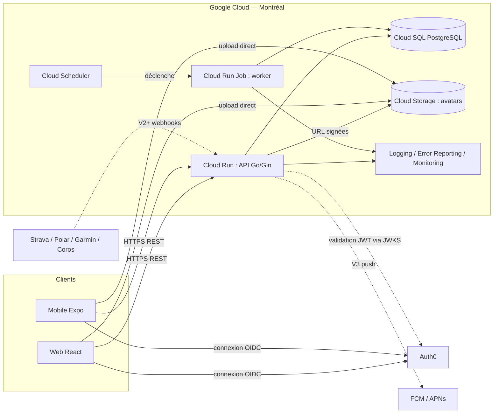
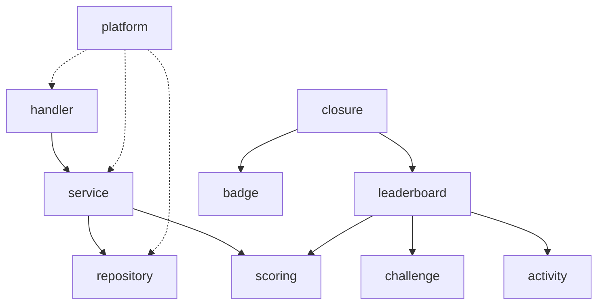

# Sport Challenge — API (backend)

Projet **backend** de l'application de challenges sportifs entre amis : API Go, base PostgreSQL, tâches planifiées.

Le **frontend** (web et mobile) est un projet séparé, avec son propre README. Le contrat entre les deux est la spécification OpenAPI de ce dépôt (`api/openapi.yaml`).

> **Légende** : ✅ décidé · 🟡 proposition par défaut, à confirmer · ❓ question ouverte

---

## 1. Concept

Une personne crée un ou plusieurs challenges sportifs, choisit une durée, la visibilité (privé ou public) et si les personnes invitées peuvent inviter à leur tour. Le classement est mis à jour pour chaque catégorie. Les activités sont saisies à la main en V1, puis synchronisées depuis Strava, Garmin, Polar et Coros dans une version ultérieure.

---

## 2. Règles fonctionnelles

### 2.1 Challenges

- ✅ Un utilisateur peut créer plusieurs challenges.
- ✅ Le créateur choisit la durée en **nombre entier de semaines, de 2 à 52** (ex. 6 semaines) : pas de dernière semaine partielle.
- ✅ Un challenge a **toujours les 3 catégories** ; le créateur règle seulement l'incrément X de la catégorie 3.
- ✅ **Plusieurs créateurs** possibles pour un même challenge.
- ✅ Visibilité :
  - **Public** : accès libre, listé sur la page d'accueil de l'app.
  - **Privé** : sur invitation d'un créateur ou d'un participant.
- ✅ Le créateur choisit si les personnes invitées peuvent aussi inviter du monde.
- ✅ **Fuseau horaire** : début et fin sont définis selon le fuseau du lieu de lancement du challenge (ex. Montréal). Les semaines sont découpées dans ce même fuseau.
- ✅ Après le début, on peut modifier le **titre** et la **description**, mais **pas les catégories**.
- ✅ Personne ne « quitte » vraiment un challenge : l'action « quitter » (ou la suppression de son compte) équivaut à un **abandon**. Les créateurs peuvent **supprimer le challenge**.
- ✅ Un challenge est **supprimable à tout moment** par n'importe quel créateur, même en cours et avec des participants, après une confirmation qui avertit que tout disparaît pour tous.
- 🟡 Suppression logique immédiate (le challenge disparaît pour tous), puis purge définitive selon la politique de conservation des données.

### 2.2 Participation

- ✅ On peut rejoindre un challenge **jusqu'à la fin de sa première semaine**.
- ✅ Un participant est **classé dans toutes les catégories** du challenge (pas d'inscription par catégorie).
- ✅ Abandonner (« quitter ») un challenge = **éliminé de toutes les catégories**, définitivement.
- ✅ Un participant qui abandonne apparaît comme « a abandonné » et sort du podium.
- ✅ Un compte supprimé est traité comme un abandon (voir §6).
- ✅ Les activités faites avant l'inscription, mais dans la fenêtre du challenge, comptent.

### 2.3 Catégories et podiums

Un challenge a **3 catégories**. **Chaque catégorie a son propre podium**, donc plusieurs gagnants par challenge. Les catégories sont figées à la création.

| # | Catégorie | Activités acceptées | Classement |
|---|---|---|---|
| 1 | **Temps cumulé** | Toutes les activités, tous sports confondus (course, yoga, escalade, aviron…) | Plus de temps cumulé |
| 2 | **Distance cumulée** | Toutes les activités qui produisent des km, ramenées à une distance de course si le sport est plus rapide | Plus de distance équivalente cumulée |
| 3 | **Course avec élimination** | Course uniquement, en distance | Voir ci-dessous |

**Catégorie 3 : course avec élimination** (la distance doit augmenter chaque semaine) :
- ✅ **X** est un **incrément en km**, choisi par le créateur à la création du challenge (ex. X = 2 km).
- ✅ Règle : la distance courue en semaine s+1 doit être **au minimum** égale à la distance de la semaine s plus X. Exemple avec X = 2 : semaine 1 = 5 km, donc semaine 2 au moins 7 km, puis semaine 3 au moins (semaine 2) + 2 km, et ainsi de suite jusqu'à la fin du challenge.
- ✅ À la fin d'une semaine, si cette condition n'est pas remplie, la personne est éliminée **de cette catégorie seulement** et reste en lice dans les deux autres.
- ✅ Le gagnant est celui qui a le plus de km cumulés.
- ✅ La « distance de la semaine s » est la distance **réellement courue** par la personne en semaine s. **Si elle court plus que le minimum requis, cette distance devient sa nouvelle base de calcul** : avec X = 2, minimum de 7 km en semaine 2 ; si elle court 10 km, le minimum de la semaine 3 est 12 km. Il n'y a donc pas de distance de départ à régler, et personne n'est éliminé en semaine 1 (pas de référence).
- ✅ Il n'y a **pas de délai de grâce** : le minimum de la semaine s+1 est définitif dès la fin de la semaine s.
- ✅ La distance d'une semaine est le cumul de toutes les courses de la semaine (pas une seule sortie).
- ✅ Les personnes qui terminent le challenge sans être éliminées sont classées par km cumulés, **quelle que soit leur base de départ** : celle qui a couru le plus de km gagne.
- ✅ Viennent ensuite les éliminés : le dernier éliminé est classé devant, et en cas d'égalité sur la semaine d'élimination, la distance cumulée départage.
- ✅ L'élimination est jugée à l'instant exact de la fin de la semaine (fuseau du challenge), sans délai de grâce.
- ✅ Une semaine terminée est **verrouillée** : aucune activité datée de cette semaine ne peut plus être ajoutée, modifiée ni supprimée (saisie manuelle comprise), puisque l'élimination est immédiate et définitive. C'est l'horloge qui fait foi, pas le passage du worker.
- ✅ Le statut live affiche « objectif atteint » dès que la distance de la semaine atteint le minimum ; sinon « à risque » quand il reste **24 h ou moins** avant la fin de la semaine, et « en cours » avant. Aucun statut en semaine 1 (pas de minimum). Le seuil de 24 h est un paramètre de configuration.

### 2.4 Équivalences de distance (catégorie 2, distance cumulée)

- ✅ Les activités **plus lentes que la course** (marche, randonnée, natation) comptent **sans coefficient** (1 pour 1).
- ✅ Les activités **plus rapides** sont ramenées à une distance de course :

| Activité | Coefficient |
|---|---|
| Course | ×1 |
| Marche, randonnée, natation et autres sports à km plus lents | ×1 |
| Vélo | ×0,3 |
| Aviron | ×0,5 |
| Roller | ×0,5 |
| Ski de fond | ×0,5 |

- Ce sont des ordres de grandeur à ajuster.
- ✅ Les coefficients sont **figés à la création du challenge** : une modification ultérieure du catalogue ne change pas un challenge en cours.
- Conséquence assumée : la marche compte pleinement, donc un marcheur peut battre un coureur en distance pure.

### 2.5 Activités

- ✅ **V1 : saisie manuelle uniquement.** Les synchronisations Strava, Garmin, Polar et Coros arrivent après.
- ✅ **Impossible d'importer une activité après la fin** du challenge.
- ✅ Une activité compte selon sa date de début, dans la fenêtre du challenge ; il n'y a pas de délai de grâce.
- ✅ Pendant la semaine en cours, un participant peut modifier ou supprimer ses propres activités ; une fois la semaine terminée, plus rien ne change (voir §2.3).
- ✅ Toutes les activités ont une **durée** ; la distance n'est demandée que pour les sports qui en produisent (pas le yoga, par exemple).
- ✅ La **vitesse (ou l'allure) n'est jamais saisie** : elle est calculée automatiquement à partir de la durée et de la distance.
- 🟡 Les activités saisies à la main sont marquées « manuelle » (surtout utile à partir de la V2, quand des activités synchronisées s'ajoutent).
- ❓ Aucun plafond de vitesse en V1 par défaut (seulement des bornes techniques : durée et distance positives, valeurs maximales raisonnables). À revoir si des abus apparaissent.
- 🟡 Un **catalogue de sports** dans l'app définit, pour chaque sport : s'il produit des km, et son coefficient.
- ✅ Un utilisateur peut **saisir un sport à la main** s'il n'est pas proposé : il choisit « autre » et écrit un libellé libre (2 à 40 caractères). ✅ Un sport saisi à la main compte toujours pour le **temps** (catégorie 1) ; la distance est **facultative** : s'il y en a une, il compte aussi pour la catégorie 2 (🟡 coefficient ×1), sinon non.
- ✅ **Une activité est saisie une seule fois** et compte dans **tous** les challenges de l'utilisateur dont la fenêtre la contient. Conséquence : une activité est non modifiable dès que sa semaine est terminée dans **l'un** de ces challenges.

### 2.6 Classement et équité

- ✅ Aucun handicap ni catégorie de niveau : tout le monde est traité à la même enseigne.
- ✅ **V1 : mise à jour du classement au rafraîchissement** de l'écran (pas de temps réel instantané).
- ✅ Égalités : classement **ex aequo** (1, 1, 3), sans départage arbitraire.
- ✅ Résultats **figés** à la fin du challenge, sans délai de grâce.
- ✅ Le classement est toujours recalculé à partir des activités brutes.

### 2.7 Badges

- ✅ **(V1.1, après la V1)** Le créateur d'un challenge peut créer **autant de badges qu'il veut** pour ce challenge. Pour chaque badge : un nom, une description et une **condition**.
- ✅ Dès qu'un participant atteint la condition, il gagne le badge (attribution immédiate, pas seulement en fin de semaine).
- ✅ Mesures possibles : **nombre d'activités**, **distance** et **temps**. La distance d'un badge est la distance **réelle**, sans coefficient ; un badge peut être limité à un sport. Exemples : un badge à 5, à 10 et à 20 activités ; un badge à 100 km cumulés ; un badge à 10 heures cumulées.
- 🟡 Une condition est une **règle structurée** (pas de code libre) : une mesure, une portée (sur tout le challenge, sur une semaine, sur une seule sortie, ou plusieurs semaines de suite), un filtre de sport (tous, course seule ou un sport donné) et un seuil (« au moins »). Les portées et le filtre se compléteront sans changer le modèle, puisque la règle est stockée en JSON.
- ✅ Un badge s'obtient une seule fois par participant. Une fois gagné, il est conservé même si l'activité est ensuite modifiée ou supprimée pendant la semaine en cours.
- ✅ Un badge créé en cours de challenge est évalué aussi sur les activités déjà enregistrées.
- 🟡 Un badge déjà gagné par quelqu'un ne peut plus être supprimé ni modifié.
- ✅ Limite de 50 badges par challenge (chaque activité déclenche l'évaluation des badges du challenge pour son auteur).

### 2.8 Profil et langues

- ✅ Pseudo et avatar. Pseudo **unique sans tenir compte de la casse**, de 3 à 20 caractères (lettres, chiffres, `_`, `.`, `-`).
- ✅ Langues : **français et anglais**.
- ✅ Unité : **km uniquement** pour le moment.

### 2.9 Modération et litiges

- ✅ Pas de système de contestation pour l'instant.
- ✅ Les créateurs peuvent ajouter un créateur et exclure un participant.
- ✅ Un participant exclu par un créateur apparaît comme un abandon (« a abandonné »), sans mention particulière ; il est éliminé de toutes les catégories, définitivement.
- ✅ Pas de système de contestation en V1 : les participants se font confiance.

### 2.10 Modèle économique

- ✅ Gratuit pour le moment.

---

## 3. Stack technique

### 3.1 Backend

- ✅ **Go** avec **Gin**, en **monolithe modulaire** (pas de microservices au départ).
- ✅ API REST avec **OpenAPI** pour générer les clients TypeScript.
- ✅ **PostgreSQL** (driver `pgx`).
- ✅ **GORM** pour le CRUD ; SQL brut (ou `sqlc`) pour les classements et agrégations.
- ✅ Migrations SQL versionnées avec **golang-migrate** (fichiers `.up.sql` et `.down.sql`). Le schéma vient uniquement des migrations : jamais `AutoMigrate`, ni en développement ni en production.
- ✅ **Pas de Redis en V1** : le classement se calcule depuis PostgreSQL, puisque la mise à jour se fait au rafraîchissement.
- ✅ Un worker (même image, autre commande) pour les tâches planifiées : clôture de semaine, éliminations, badges, gel des résultats.

### 3.2 Authentification

- ✅ Service tiers pour les comptes et la connexion (OIDC) : Google, Apple, lien magique ou e-mail.
- ✅ **Auth0**, avec un tenant par environnement (développement, staging, production). ❓ À vérifier à la création du premier tenant : région **Canada** disponible avec le forfait voulu, et lien magique inclus dans ce forfait. Plan B si le Canada n'est pas disponible : Google Identity Platform (gratuit jusqu'à 50 000 utilisateurs actifs par mois), en documentant l'évaluation de transfert hors Québec car on n'y choisit pas la région des données.
- Le backend reste indépendant du fournisseur (interface `TokenVerifier`, identifiant d'utilisateur local, validation JWT par JWKS) : un changement ultérieur ne toucherait pas les modules métier.
- ❓ Vérifier la région du tenant (Canada) avant de le créer, car elle ne se change pas ensuite.
- Sign in with Apple obligatoire sur iOS si une autre connexion sociale est proposée.
- Le backend valide le JWT et garde son propre `user_id` lié à l'identifiant du fournisseur.

### 3.3 Stockage d'images

- Avatars sur **Cloud Storage**, avec URL signées : le mobile et le web envoient le fichier directement au bucket.
- Validation du type et de la taille côté serveur.

---

## 4. Hébergement et infrastructure

- ✅ **Google Cloud Platform**, région **Montréal** (`northamerica-northeast1`), car les premiers utilisateurs sont au Canada.
- Services prévus :

| Besoin | Service GCP |
|---|---|
| API et worker | **Cloud Run** (service et jobs) |
| Tâches planifiées | **Cloud Scheduler** |
| Base de données | **Cloud SQL (PostgreSQL)** avec sauvegardes |
| Images | **Cloud Storage** (CDN plus tard) |
| Secrets | **Secret Manager** |
| Images Docker | **Artifact Registry** |
| Logs, erreurs, alertes | **Cloud Logging, Error Reporting, Monitoring** |

- ✅ **Docker** multi-stage (binaire statique, image minimale).
- ✅ Pas de Kubernetes : Cloud Run suffit.
- ✅ **Environnements** : un projet GCP par environnement, dont un **staging** pour les tests, séparé de la production (base, Auth, projet).
- 🟡 **Horloge réglable en staging** pour tester les clôtures de semaine en quelques minutes.
- 🟡 **CI/CD** : GitHub Actions (tests, build, push, migrations, déploiement Cloud Run), avec authentification sans clé (Workload Identity Federation).
- 🟡 **Terraform** pour décrire l'infrastructure.
- ⚠️ Mettre une **alerte de budget** dès le premier jour (Cloud SQL a un coût fixe).

### Observabilité et analytics

- ✅ Logs, suivi des erreurs (ex. Sentry) et alertes : prévus.
- ✅ Analytics produit prévus plus tard, avec consentement et un outil compatible avec les lois de protection des données.

---

## 5. Architecture backend

### 5.1 Vue d'ensemble



- ✅ **Monolithe modulaire** : un seul dépôt et une seule image Docker, avec deux commandes : `api` (requêtes HTTP) et `worker` (tâches planifiées).
- ✅ Le worker est lancé par Cloud Scheduler, sans serveur permanent.
- 🟡 Chaque module a ses couches : **handler** (HTTP) → **service** (règles métier) → **repository** (base de données).

### 5.2 Structure détaillée du dépôt backend

> Cette structure est la **cible**. Chaque dossier et chaque fichier sont créés par le premier ticket qui les utilise (pas de squelette vide ni de code écrit d'avance), voir `TASKS.md`.

```
sportchallenge-api/
├── cmd/
│   ├── api/
│   │   └── main.go                  assemble config, base, services, routes et lance le serveur HTTP
│   └── worker/
│       └── main.go                  sous-commandes : close-weeks, finalize-challenges (V2 : sync, refresh-tokens)
├── internal/
│   ├── platform/                    socle technique, importé par tous les modules
│   │   ├── config/                  lecture et validation des variables d'environnement
│   │   ├── db/                      connexion PostgreSQL, helper de transactions
│   │   ├── httpx/                   middlewares Gin : auth, identifiant de requête, logs, recovery, CORS,
│   │   │                            limitation de débit ; conversion des erreurs en réponses JSON
│   │   ├── auth/                    interface TokenVerifier (JWKS), middlewares Authenticate et CurrentUser
│   │   ├── storage/                 interface de stockage + implémentation Cloud Storage (URL signées)
│   │   ├── clock/                   interface Clock : horloge réelle, horloge décalable (staging, tests)
│   │   ├── logger/                  logs structurés JSON
│   │   └── apperr/                  erreurs métier avec code stable (traduit côté client)
│   │
│   ├── user/
│   │   ├── model.go                 entité User
│   │   ├── service.go               création au premier login, profil, suppression (anonymisation)
│   │   ├── repository.go            accès base (GORM)
│   │   ├── handler.go               routes /me
│   │   └── service_test.go
│   │
│   ├── challenge/
│   │   ├── model.go                 Challenge, Category, Participant, CreatorLink
│   │   ├── rules.go                 validation pure : fuseau, dates, paramètres de catégories
│   │   ├── policy.go                qui peut faire quoi (fonctions pures, testées sans base)
│   │   ├── service.go               création, modification limitée, rejoindre, abandonner, exclure, supprimer
│   │   ├── repository.go
│   │   ├── handler.go
│   │   └── rules_test.go
│   │
│   ├── invitation/
│   │   ├── model.go · service.go · repository.go · handler.go
│   │                                liens d'invitation, règle « les invités peuvent inviter »
│   │
│   ├── sport/
│   │   ├── catalog.go               catalogue : code, nom, produit des km, coefficient
│   │   ├── service.go               lecture du catalogue, copie des coefficients dans le challenge
│   │   └── handler.go               GET /sports
│   │
│   ├── activity/
│   │   ├── model.go                 Activity (source, identifiant externe, sport, durée, distance)
│   │   ├── limits.go                bornes techniques (durée et distance positives, valeurs maximales raisonnables) ; vitesse calculée
│   │   ├── policy.go                qui peut saisir, modifier, supprimer (auteur, semaine en cours)
│   │   ├── service.go               validation, fenêtre du challenge, idempotence
│   │   ├── repository.go
│   │   ├── handler.go
│   │   └── limits_test.go
│   │
│   ├── scoring/                     Go pur, sans dépendance : testé sans base de données
│   │   ├── types.go                 Activity, Window, Entry, interface Scorer
│   │   ├── window.go                semaines découpées dans le fuseau du challenge
│   │   ├── distance.go              catégorie 2 : distance cumulée (coefficients)
│   │   ├── duration.go              catégorie durée
│   │   ├── elimination.go           catégorie à élimination
│   │   ├── ranks.go                 classement ex aequo (1, 1, 3)
│   │   └── *_test.go
│   │
│   ├── leaderboard/
│   │   ├── service.go               charge participants et activités, appelle les scorers
│   │   └── handler.go               GET /challenges/{id}/leaderboard
│   │
│   ├── closure/
│   │   ├── service.go               clôture de semaine, éliminations, gel des résultats
│   │   └── jobs.go                  points d'entrée appelés par le worker
│   │
│   ├── badge/
│   │   ├── model.go                 BadgeDefinition (par challenge, règle en JSON), BadgeAward
│   │   ├── rules.go                 évaluation pure d'une condition de badge (sans base de données) ; testée
│   │   ├── service.go · repository.go · handler.go
│   │
│   ├── integration/                 V2 et suivantes
│   │   ├── provider.go              interface Provider commune
│   │   ├── connection/              connexions OAuth, jetons chiffrés, renouvellement
│   │   ├── webhook/                 route publique, vérification de signature
│   │   ├── dedupe/                  règle de fusion des doublons entre marques
│   │   ├── strava/ · polar/ · garmin/ · coros/     un adaptateur par marque
│   │
│   └── notification/                V3 : FCM et APNs
│
├── migrations/                      000001_init.up.sql / .down.sql, 000002_… (golang-migrate, appliqué par la CI)
├── api/
│   └── openapi.yaml                 spécification de l'API (source du client TypeScript)
├── deploy/
│   ├── Dockerfile                   build multi-stage, image minimale
│   ├── docker-compose.yml           local : API, worker, PostgreSQL, émulateur de stockage
│   └── terraform/
│       ├── modules/                 cloud-run, cloud-sql, storage, scheduler, secrets
│       └── envs/                    staging/ et prod/ (un projet GCP chacun)
├── .github/workflows/               ci.yml, deploy-staging.yml, deploy-prod.yml
├── Makefile                         raccourcis : test, lint, migrate, run
├── go.mod
└── README.md
```

**Règles de dépendance**



- Un `handler` ne contient aucune règle métier : il lit la requête, appelle le `service`, renvoie la réponse.
- Seul le `repository` parle à la base. Un module n'importe jamais le `repository` d'un autre module.
- Les modules se parlent par de petites **interfaces définies côté consommateur** (ex. `leaderboard` déclare ce dont il a besoin de `activity`).
- `scoring` n'importe rien d'autre que la bibliothèque standard.
- `platform` peut être importé par tous ; il n'importe aucun module métier.
- Les tests unitaires sont à côté du code ; les tests d'intégration utilisent PostgreSQL en conteneur.

**Routes par module**

| Module | Routes (`/api/v1`) |
|---|---|
| `user` | `GET /me`, `PATCH /me`, `DELETE /me` |
| `challenge` | `POST /challenges`, `GET /challenges` (publics et les miens), `GET /challenges/{id}`, `PATCH /challenges/{id}` (titre, description), `POST /challenges/{id}/join`, `POST /challenges/{id}/abandon`, `GET /challenges/{id}/participants`, `DELETE /challenges/{id}/participants/{userId}` (exclure), `POST /challenges/{id}/creators`, `DELETE /challenges/{id}` (créateurs : supprimer le challenge) |
| `invitation` | `POST /challenges/{id}/invitations`, `GET /invitations/{token}`, `POST /invitations/{token}/accept` |
| `leaderboard` | `GET /challenges/{id}/leaderboard` (filtre par catégorie) |
| `activity` | `POST /activities`, `GET /me/activities`, `GET /challenges/{id}/participants/{userId}/activities` (participants du challenge), `PATCH` et `DELETE /activities/{id}` (auteur, tant que la semaine n'est pas terminée dans aucun challenge où l'activité compte) |
| `sport` | `GET /sports` |
| `badge` | `GET /me/badges`, `GET /challenges/{id}/badges`, `POST /challenges/{id}/badges` (créateur), `PATCH` et `DELETE /challenges/{id}/badges/{badgeId}` (créateur, tant que personne ne l'a gagné) |
| uploads | `POST /uploads/avatar` (URL signée) |
| `integration` (V2) | `GET /integrations`, `POST /integrations/{provider}/connect`, `DELETE /integrations/{provider}`, `POST /webhooks/{provider}` (public) |
| santé | `GET /healthz` |

**Tâches du worker**

- `close-weeks` : clôt les semaines terminées (fin de semaine atteinte), enregistre les éliminations, évalue les badges de type « plusieurs semaines de suite ».
- `retry-auth0-deletions` : rejoue la suppression chez Auth0 des utilisateurs dont l'appel a échoué.
- `finalize-challenges` : fige les résultats des challenges terminés (statut « terminé », classements enregistrés).
- 🟡 Cloud Scheduler les lance **toutes les heures**, car les semaines se terminent à des heures différentes selon le fuseau de chaque challenge. Chaque tâche est **idempotente** : la relancer ne change rien si le travail est déjà fait.

### 5.3 Responsabilités des modules

| Module | Responsabilité |
|---|---|
| `user` | Crée la ligne locale au premier login, gère pseudo, avatar, langue |
| `challenge` | Création, modification limitée (titre, description), fuseau, durée, visibilité, règle d'invitation, co-créateurs |
| `invitation` | Liens et invitations pour les challenges privés, selon la règle « les invités peuvent inviter » |
| `sport` | Catalogue des sports et coefficients de distance, figés par challenge à sa création |
| `activity` | Saisie manuelle, validation (durée obligatoire, distance selon le sport, vitesse calculée et jamais saisie), marquage « manuelle », ignore les activités hors fenêtre |
| `scoring` | Calcule un classement à partir d'activités et de règles, sans dépendance à la base ni à Gin |
| `leaderboard` | Charge participants et activités, appelle les scorers, renvoie un classement par catégorie |
| `closure` | À chaque fin de semaine : éliminations, badges « semaines de suite » ; à la fin du challenge : gel des résultats |
| `badge` | Badges créés par les créateurs d'un challenge (nom, description, condition structurée) ; évaluation à chaque nouvelle activité, attribution idempotente |
| `integration` | (V2+) Connexion OAuth au fournisseur, réception des webhooks, import, dédoublonnage |

### 5.4 Modèle de données (entités principales)

| Entité | Champs clés |
|---|---|
| `user` | id, identifiant du fournisseur d'auth, pseudo, avatar, langue |
| `challenge` | id, titre, description, visibilité, invités peuvent inviter, fuseau, début et fin (UTC), statut |
| `challenge_creator` | challenge, utilisateur |
| `category` | challenge, nom, type (temps cumulé, distance cumulée, course avec élimination), paramètres figés |
| `participant` | challenge, utilisateur, statut (actif ou abandonné), date d'inscription |
| `invitation` | challenge, invité par, jeton ou destinataire, état |
| `sport` | code, nom, produit des km, coefficient |
| `activity` | utilisateur, sport, libellé du sport (si « autre »), date de début (UTC), durée, distance, source (manuelle ou fournisseur), identifiant externe, clé d'idempotence |
| `week_closure` | challenge, numéro de semaine, date de clôture |
| `elimination` | participant, catégorie, semaine d'élimination |
| `badge_definition` | challenge, nom, description, règle (JSON structuré), créateur, date de création |
| `badge_award` | badge, utilisateur, date d'obtention, activité déclencheuse (si applicable) ; unique (badge, utilisateur) |
| `result_snapshot` | challenge, catégorie, classement figé en fin de challenge |

Index à prévoir : `activity (utilisateur, date de début)`, `participant (challenge)`, `category (challenge)`.

### 5.5 Flux principaux

1. **Création d'un challenge** : validation (fuseau, dates, catégories) → challenge, catégories et premier créateur enregistrés → le créateur devient participant.
2. **Saisie d'une activité** (point d'entrée unique) : validation (challenge en cours, date dans la semaine en cours : une semaine terminée est verrouillée) → stockage avec source « manuelle » → aucun recalcul stocké.
3. **Lecture du classement** (au rafraîchissement) : chargement des participants et des activités de la fenêtre → un scorer par catégorie → classement ex aequo renvoyé au client. Le calcul se fait toujours depuis les activités brutes.
4. **Clôture hebdomadaire** : Cloud Scheduler lance le worker → pour chaque challenge actif dont une semaine est terminée → éliminations (catégorie à élimination) enregistrées → badges « semaines de suite » évalués.
5. **Fin de challenge** : à l'instant de fin → statut « terminé », `result_snapshot` enregistré. Plus aucune activité ne peut être ajoutée.
6. **Abandon d'un participant** : statut « abandonné » (volontairement, ou après l'exclusion par un créateur), éliminé de toutes les catégories, apparaît comme « a abandonné ».
7. **Badges** : après l'enregistrement d'une activité, évaluation des badges du challenge pour son auteur ; attribution immédiate et idempotente (unique par badge et utilisateur). Les conditions « plusieurs semaines de suite » sont évaluées à la fin de chaque semaine par le worker.

### 5.6 API

- ✅ REST sous `/api/v1`, spécification OpenAPI (génération du client TypeScript).
- Ressources principales : `me`, `challenges`, `challenges/{id}/categories`, `challenges/{id}/participants`, `challenges/{id}/leaderboard`, `challenges/{id}/invitations`, `activities`, `sports`, `badges`, `uploads` (URL signées).
- 🟡 Les erreurs renvoient un **code stable** (traduit côté client en français ou en anglais), pas un texte.
- 🟡 Les créations d'activité acceptent une **clé d'idempotence** (utile pour le hors-ligne et les futures synchronisations).
- 🟡 Pagination par curseur sur les listes.

### 5.7 Authentification et autorisation

**Chaîne de middlewares Gin (dans cet ordre)**

| # | Middleware | Rôle |
|---|---|---|
| 1 | `Recovery` | Transforme un plantage en erreur 500 propre, sans arrêter le serveur |
| 2 | `RequestID` | Identifiant de requête, repris dans les logs et les réponses d'erreur |
| 3 | `Logger` | Logs structurés (`slog`), sans donnée personnelle ni jeton |
| 4 | `CORS` | Origines explicites (web uniquement), jamais `*` avec des identifiants |
| 5 | `RateLimitIP` | Limite de débit par adresse IP, avant tout travail coûteux ; répond 429 au-delà |
| 6 | `Authenticate` | Lit le jeton `Bearer`, le vérifie (signature par JWKS, émetteur, audience, expiration), place les informations du jeton dans le contexte |
| 7 | `CurrentUser` | Retrouve l'utilisateur local à partir de l'identifiant du fournisseur (`sub`), le crée au premier login, place son identifiant dans le contexte |
| 8 | `RateLimitUser` | Limite de débit par utilisateur, sur les routes d'écriture et d'upload seulement |

**Groupes de routes**
- Publiques, sans jeton : `GET /healthz`.
- Protégées (tout le reste de `/api/v1`) : middlewares 1 à 7.
- ✅ Connexion **obligatoire** pour toutes les routes, y compris la lecture des challenges publics (V1). Pas de middleware `OptionalAuth` pour l'instant.
- V2 : `POST /webhooks/{provider}` n'utilise pas le jeton utilisateur mais un middleware de **vérification de signature** du fournisseur.

**Indépendance du fournisseur**
- `platform/auth` définit une interface `TokenVerifier`. Auth0 émet des jetons JWT vérifiables par clés publiques (JWKS) : l'adresse des clés, l'émetteur et l'audience viennent de la configuration (`AUTH0_DOMAIN`, `AUTH0_AUDIENCE`). Un autre fournisseur JWT s'ajouterait sans toucher au reste.
- Le reste de l'application ne connaît que l'identifiant de l'utilisateur local : changer de fournisseur ne touche ni les modules métier ni la base (hors la correspondance `sub` → utilisateur).

**Autorisation** (pas dans un middleware)
- Chaque service vérifie le rôle : créateur, participant ou public. Un utilisateur ne peut jamais agir sur une ressource d'un autre en changeant un identifiant.
- ✅ Un challenge privé n'est lisible que par ses participants et invités ; une ressource privée inconnue renvoie 404 plutôt que 403 pour ne pas révéler son existence.

**Comment l'autorisation est vérifiée** : chaque cas d'usage du service reçoit explicitement **qui agit** (`actorID`), charge la ressource, puis appelle une fonction de politique pure (`policy.go`) avant toute écriture. Le handler ne peut pas contourner le service, et le repository n'est jamais appelé directement par un handler. Les listes filtrent dans la requête SQL (jamais « tout charger puis retirer »).

**Matrice des droits**

| Action | Qui peut |
|---|---|
| Voir un challenge public et son classement | tout utilisateur connecté (✅) |
| Voir un challenge privé et son classement | participants, invités et créateurs (✅) |
| Rejoindre un challenge public | tout utilisateur connecté, jusqu'à la fin de la semaine 1 (✅) |
| Rejoindre un challenge privé | sur invitation valide, jusqu'à la fin de la semaine 1 (✅) |
| Inviter | créateurs ; participants seulement si le créateur l'a autorisé à la création (✅) |
| Modifier titre et description | créateurs (✅) |
| Modifier les catégories | personne, après la création (✅) |
| Ajouter un créateur | créateurs (✅) |
| Exclure un participant | créateurs (✅) |
| Créer un badge | créateurs (✅) |
| Modifier ou supprimer un badge | créateurs, tant que personne ne l'a gagné (🟡) |
| Saisir une activité | le participant, pour lui-même, sur la semaine en cours d'un challenge en cours (✅) |
| Modifier ou supprimer une activité | son auteur, tant que sa semaine n'est pas terminée (✅) |
| Abandonner (« quitter ») un challenge | le participant, pour lui-même ; équivaut à un abandon définitif (✅) |
| Supprimer le challenge | créateurs, à tout moment (✅) |
| Voir le détail des activités (date, sport, durée, distance) d'un participant | les participants du même challenge et les créateurs (✅) ; un non-participant d'un challenge public ne voit que le classement (✅) |

**Codes de réponse** : ressource inexistante ou privée inaccessible → 404 ; ressource visible mais action interdite → 403 `forbidden` ; règle métier violée (par exemple modifier les catégories) → 422 avec un code stable.

**Protections** : l'identifiant de l'acteur vient toujours du contexte (jamais d'un paramètre) ; le contrôle et l'écriture se font dans la même transaction quand une course est possible (rejoindre à la limite de la semaine 1, suppression du challenge pendant qu'un participant le rejoint) ; chaque règle a un test « interdit » ; l'agent `security-reviewer` vérifie ce point à chaque revue.

### 5.8 Éléments transverses

- ✅ **Horloge injectable** : toute règle qui dépend du temps passe par une horloge réglable, pour tester les clôtures en staging.
- Configuration par variables d'environnement, secrets dans Secret Manager.
- Logs structurés en JSON (lus par Cloud Logging), avec un identifiant de requête.
- Limitation de débit sur les routes d'écriture et d'upload.
- **Erreurs** (✅) : `platform/apperr` est écrit pour ce projet. Le package maison de Faunadex (`apierrors` et `translator`) n'est **pas repris** : il renvoie un code numérique et un message traduit par le serveur, sans paramètres ni cause chaînée. Contrat : un **code stable** (`snake_case`, en anglais) ; un statut HTTP associé ; des **paramètres** optionnels pour les textes avec valeur (par exemple la date limite) ; une **cause** chaînée (`errors.Is` et `errors.As` fonctionnent), jamais exposée au client ; aucune donnée personnelle dans les paramètres. Réponse unique : `{ "error": { "code", "message", "params", "request_id" } }`, construite à **un seul endroit** (`platform/httpx`). Les textes d'erreur affichés dans l'app viennent des fichiers de traduction du frontend, indexés par le code ; le `message` du serveur n'est qu'un texte de secours pour les autres clients. La traduction côté serveur sert aux textes **émis par le serveur** (courriels, notifications push). Les codes sont listés dans `openapi.yaml`.
- 🟡 **Tests** : unitaires sur `scoring` et les validations (sans base), d'intégration avec PostgreSQL en conteneur dans la CI, tests de bout en bout sur staging.

### 5.9 Intégrations sportives (V2+)

- Une interface **Provider** commune à Strava, Polar, Garmin et Coros : connexion OAuth, réception des webhooks, récupération d'une activité, conversion du sport vers le catalogue.
- Table des connexions avec jetons **chiffrés**, gestion du renouvellement et de la révocation.
- Route de webhook publique, vérifiée par signature ou jeton du fournisseur.
- **Dédoublonnage** : une même sortie peut arriver par deux marques ; règle de fusion basée sur l'heure de début, la durée et la distance.
- Mise à jour et suppression côté fournisseur répercutées tant que la semaine concernée n'est pas terminée ; une activité reçue après la fin de sa semaine ne compte plus (❓ à revisiter, voir §8).

### 5.10 Ce que la V1 prépare pour la V2

La V2 (synchronisations) a peu d'impact sur la V1 si ces choix, presque gratuits, sont faits dès le départ :
- 🟡 `activity` porte déjà une `source` (« manuelle » en V1) et un `external_id` nul en V1, avec une contrainte d'unicité (`source`, `external_id`) quand il est renseigné.
- 🟡 `activity` a des dates de création, de modification et de suppression, car un fournisseur peut modifier ou supprimer une activité.
- 🟡 **Point d'entrée unique** pour créer une activité : la saisie manuelle et, plus tard, les imports passent par le même service, où s'appliquent le verrouillage des semaines, l'évaluation des badges et les contrôles de validité.
- Tout le reste (connexions OAuth, webhooks, correspondance des sports par marque, déduplication, jetons chiffrés) s'ajoute en V2 par des migrations additives, sans toucher aux tables de la V1.
- Les règles propres aux synchronisations (activités tardives, agrégateur ou connexions directes) se décident en V2 et n'affectent pas les règles de la V1.

---

## 6. Données, légalité et conformité

> Je ne suis pas juriste : ces points sont à faire valider avant le lancement public.

- **Loi 25 (Québec)** applicable aux utilisateurs québécois : politique de confidentialité claire en français et en anglais, consentement explicite, personne responsable de la protection des renseignements, registre des incidents, évaluation avant tout transfert hors Québec.
- **LCAP (Canada)** pour les courriels promotionnels.
- **RGPD** si des utilisateurs européens s'ajoutent.
- ✅ **Suppression de compte** : anonymisation, traitée comme un abandon dans tous les challenges ; l'utilisateur est aussi **supprimé chez Auth0** (API de gestion, avec reprise en cas d'échec) pour que l'effacement soit réel.
- ✅ Les activités détaillées d'un participant sont visibles par les autres participants du challenge : l'app l'indique **avant** de rejoindre, et la politique de confidentialité le mentionne.
- 🟡 Ne stocker que les **résumés d'activité** (distance, durée, type, date), pas les traces GPS.
- Tenir un **inventaire des sous-traitants** (Auth, notifications, analytics, fournisseurs sportifs) avec la région de chacun.
- Respecter les conditions d'usage de chaque API sportive (affichage, marque, quotas).

---

## 7. Feuille de route

### V1, phase par phase (même ordre que le skill `bootstrap`)

Le détail ticket par ticket (67 tickets, critères d'acceptation, commits proposés) est dans [`TASKS.md`](TASKS.md) (importé en issues GitHub, voir « Les tickets vivent dans GitHub »).

| Phase | Contenu | Points à ne pas oublier |
|---|---|---|
| 0 | Fondations minimales et CI | `go.mod` ; `Makefile` limité au nécessaire, avec garde-fou : les migrations ne s'appliquent que sur la base locale ; `docker-compose` (PostgreSQL) ; lint ; CI GitHub Actions ; relecture des pull requests par Claude |
| 1 | Serveur minimal | `config` réduite aux variables utilisées, `slog`, middlewares `Recovery`, `RequestID`, `Logger`, `GET /healthz` et `/readyz`. Le reste du socle (**`apperr`**, §5.8, `clock` injectable, transactions, pagination, `CORS`) arrive avec la première fonctionnalité qui l'utilise |
| 2 | Utilisateur et **Auth0** | Middlewares `Authenticate`, `CORS`, `CurrentUser` (la limitation de débit par IP et par utilisateur vient en phase 9, avant l'exposition publique) ; interface `TokenVerifier` ; **access token** de l'API (pas l'ID token) ; tenant Auth0 par environnement (région Canada et lien magique à vérifier) ; création de l'utilisateur au premier login, idempotente ; connexion **obligatoire** partout sauf `/healthz` |
| 3 | Catalogue de sports | Données de référence idempotentes ; coefficients copiés dans le challenge à sa création |
| 4 | Challenges et catégories | **`policy.go`** (matrice des droits §5.7) ; **aucune autorisation dans un middleware** ; 3 catégories figées ; inscription jusqu'à la fin de la semaine 1 ; plusieurs créateurs ; titre et description seuls modifiables ; test « interdit » pour chaque règle |
| 5 | Activités | **Point d'entrée unique** ; `source` et `external_id` ; **semaine terminée verrouillée** ; modification et suppression seulement dans la semaine en cours ; route de détail des activités des participants (visible des seuls participants du challenge) |
| 6 | Scoring et classement | Tests d'abord ; catégorie 3 : minimum = distance réelle de la semaine précédente + X, aucune élimination en semaine 1, sans délai de grâce ; classement des éliminés (dernier éliminé devant, puis km) ; ex aequo |
| 7 | Clôtures et worker | `close-weeks` et `finalize-challenges` toutes les heures, **idempotents** ; résultat indépendant du moment où le worker passe ; horloge réglable en staging |
| 8 | Invitations (badges reportés en V1.1) | Invitations avec la règle « les invités peuvent inviter » ; les badges (conditions structurées, évaluation après chaque activité) viennent en V1.1 |
| 9 | Limitation de débit et déploiement | `RateLimitIP` et `RateLimitUser`, Docker, compléments de CI/CD, Terraform, staging, alerte de budget ; jamais de `terraform apply` sans demande |

**À chaque phase** : `make check` passe ; chaque nouvelle route a ses tests d'autorisation (autorisé, interdit, inexistant) ; les erreurs ont un code stable ; aucune donnée personnelle dans les logs ; une paire de migrations par changement de schéma ; les agents de relecture sont lancés ; **aucun commit ni push sans validation explicite**.

### V1.1 (après la V1)

Badges créés par les créateurs (§2.7) et upload d'avatar par URL signée (avatars par défaut en V1).

### V2

Synchronisation Strava (webhooks), puis Polar. Les règles propres aux synchronisations (activités tardives, agrégateur ou connexions directes) se décident à ce moment-là (§5.10).

### V3

Garmin et Coros (demandes de partenariat à lancer tôt, les délais sont longs), notifications push, flux temps réel (SSE).

---

## 8. Questions ouvertes

- ❓ (V2) Synchronisations tardives (Garmin, Coros) : sans délai de grâce, une activité reçue après la fin de sa semaine ne compte pas. À revisiter à l'arrivée des synchronisations.
- ❓ À la création du tenant Auth0 : région Canada et lien magique disponibles avec le forfait voulu (plan B : Google Identity Platform).
- ❓ Agrégateur ou connexions directes pour les synchronisations (à trancher avant la V2).
- ✅ Package d'erreurs maison (Faunadex) : examiné, non repris. `platform/apperr` suit le contrat du §5.8 ; ses messages FR/EN pourront alimenter les fichiers de traduction du frontend. Le `translator` (`go-i18n`, fichiers `.toml`) pourra servir plus tard aux textes émis par le serveur (courriels, notifications).
- ❓ Confirmer les points marqués 🟡.
